# MINT final test (E5, OPV2V): results report

> **Status: DEVELOPMENT / DRY RUN - not results**
> Source: DRY RUN (development dev slice; not results)
>
> These numbers come from development data. They show what the report will look like; they are **not** results of the final test and must not be quoted as such.

Generated 2026-10-25T18:02:31+05:30 by `runners/report_build.py`. Every number in this report is copied from the analysis outputs listed below; nothing is recomputed. Sections marked **AUTHOR** are left for the authors to write after reading the results.

| Provenance | |
|---|---|
| `e5_v3.json` | `runs/20261024-E5/dryrun_v3_2/n2/e5_v3.json` · sha256 `2c1eda336e5e754c…` |
| `e5_test.json` | `runs/20261024-E5/dryrun_v3_2/n2/e5_test.json` · sha256 `e7323c492a22f15c…` |
| `preregistration` | `runs/20261024-E5/preregistration_v3_2.json` · sha256 `8756868def368e85…` |
| Repository HEAD | `5642cecb3dfea2823018b125e6a19a8af431feb6` |
| Frozen code commit (preregistration) | `c883753f91c75e707d5df5fce8757851fad494de` |
| Preregistration version | v3.2 (supersedes v3.1 runs/20261024-E5/preregistration_v3_1.json only by D-71; v1, v2, v3 and v3.1 kept unchanged) |
| Scenarios / frames | 1 / 24 (agents per frame: {'2': 24}) |

## 1. What was tested

**Defenses compared** (pre-registered comparison set): no defense; ego-only; B-NORM (D-66, new); B-RAY (primary); R1 (key secondary); R1-noREMOVE (ablation); oracle bounds as v2 (frozen e5_analyze).

**Conditions** (12): clean (no attack); spoof - feature; remove - feature; shift - feature; spoof - points; spoof in receiver-blind area; PGD untargeted r=0.25; PGD remove r=0.25; PGD untargeted stealth r=0.5; PGD remove stealth r=0.25; PGD untargeted stealth r=1.0 †; PGD remove stealth r=1.0 †.

† pgd_remove_stealth@r1.0, pgd_untargeted_stealth@r1.0: strong-attack level, added after seeing block-H development results (D-70, secondary; never used for a criterion).

**Metrics.** ΔAP@0.7 = AP of a defense minus AP with no defense on the same frames, in AP points (×100). Recovery = ΔAP / attack loss. Clean cost = relative AP@0.7 loss on unattacked frames. Every statistic is computed under two AP definitions: global-ranking AP (headline) and frame-order AP (OPV2V-comparable).

**Pre-registered rule (D-64).** every primary and key-secondary statistic is computed under both definitions with the same bootstrap (seed 0, 2000 resamples, scenario and 10-frame). The v2 success rule (B-RAY Holm-rejected in the co-test with R1 vs no defense on the scenario bootstrap, and B-RAY clean relative loss scenario-CI high <= 1%) is evaluated separately per AP definition, Holm within each definition. A success/robustness claim requires a pass under BOTH. Headline numbers are quoted with global-ranking AP; frame-order AP is reported for comparability with OPV2V papers. If the two disagree the report states 'AP-definition-dependent'. R1 - B-RAY (statement by scenario CI, v2 wording) is reported under both, side by side.

**Outcome wording.** Success: only if the v2 rule passes under both AP definitions (D-64); headline in global-ranking AP. Disagreement: report 'AP-definition-dependent'. Failure: report as the result; no rescue analysis presented as confirmatory.

## 2. Procedural checks

| Check | Detail | Passed |
|---|---|---|
| Completeness (scenarios, frames) | 1/15 scenarios, 24/2066 frames | no |
| Frame-order v3 = frozen v2 analysis | 4 statistics, point and scenario CI | yes |
| NumPy AP vs OpenCOOD AP | max abs. difference 4.0e-15 | yes |
| Compose checks identical (all scenarios) | 1 scenarios | yes |

## 3. Pre-registered verdict

**Success under both AP definitions.** v2 rule under global-ranking AP: passes; under frame-order AP: passes.

| AP definition | B-RAY ΔAP | B-RAY p (1-sided) | B-RAY Holm reject | R1 ΔAP | R1 p | R1 Holm reject | B-RAY clean loss CI (%) | clean CI high ≤ 1% | v2 rule passes |
|---|---|---|---|---|---|---|---|---|---|
| global-ranking AP (headline) | +0.54 | 0.0050 | yes | +0.32 | 0.0050 | yes | [+0.00, +0.00] | yes | yes |
| frame-order AP (OPV2V-comparable) | +1.33 | 0.0050 | yes | +0.73 | 0.0050 | yes | [+0.00, +0.00] | yes | yes |

**Key secondary (R1 − B-RAY), statements emitted by the frozen analysis:**

| AP definition | R1 − B-RAY (pts) | 95% CI scen. | 95% CI 10-frame | Pre-registered statement |
|---|---|---|---|---|
| global-ranking AP (headline) | -0.22 | [-0.22, -0.22] | [-0.48, +0.00] | “the counterfactual performs worse than the box-level filter” |
| frame-order AP (OPV2V-comparable) | -0.61 | [-0.61, -0.61] | [-1.39, +0.00] | “the counterfactual performs worse than the box-level filter” |

## 4. Headline: mean ΔAP@0.7 over the 4 original attacks

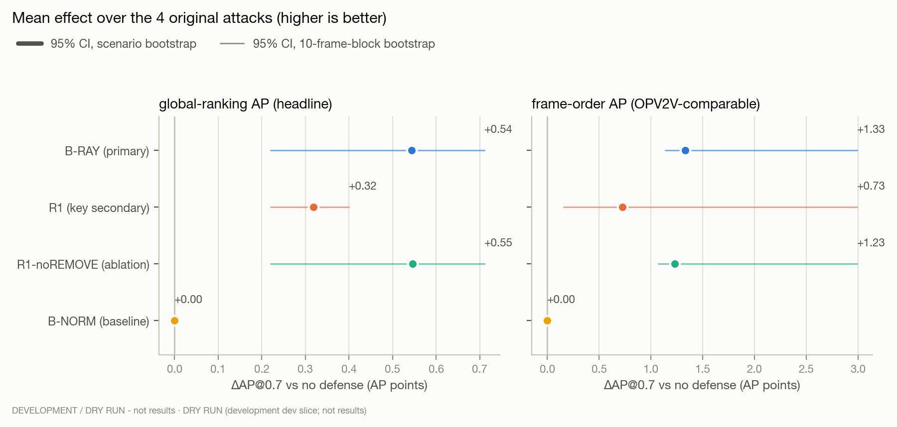

*Figure 1. Each defense's mean change in AP@0.7 against no defense, over spoof/remove/shift (feature) and spoof (points). Dot = point estimate; thick line = 95% CI from the scenario bootstrap (the pre-registered primary CI); thin line = 10-frame-block bootstrap. Ego-only is far off-scale and is listed in the table only.* Data: [`tables/01_headline.csv`](tables/01_headline.csv) · dark version: [`figures/01_headline_dark.png`](figures/01_headline_dark.png)

| Method | ΔAP@0.7 global | 95% CI scen. global | 95% CI 10-frame global | ΔAP@0.7 frame | 95% CI scen. frame | 95% CI 10-frame frame |
|---|---|---|---|---|---|---|
| B-RAY (primary) | +0.54 | [+0.54, +0.54] | [+0.22, +0.71] | +1.33 | [+1.33, +1.33] | [+1.14, +2.99] |
| R1 (key secondary) | +0.32 | [+0.32, +0.32] | [+0.22, +0.40] | +0.73 | [+0.73, +0.73] | [+0.16, +2.99] |
| R1-noREMOVE (ablation) | +0.55 | [+0.55, +0.55] | [+0.22, +0.71] | +1.23 | [+1.23, +1.23] | [+1.07, +2.99] |
| B-NORM (baseline) | +0.00 | [+0.00, +0.00] | [+0.00, +0.00] | +0.00 | [+0.00, +0.00] | [+0.00, +0.00] |
| Ego-only | -12.93 | [-12.93, -12.93] | [-14.28, -9.37] | -15.07 | [-15.07, -15.07] | [-18.58, -6.21] |

## 5. Every attack condition

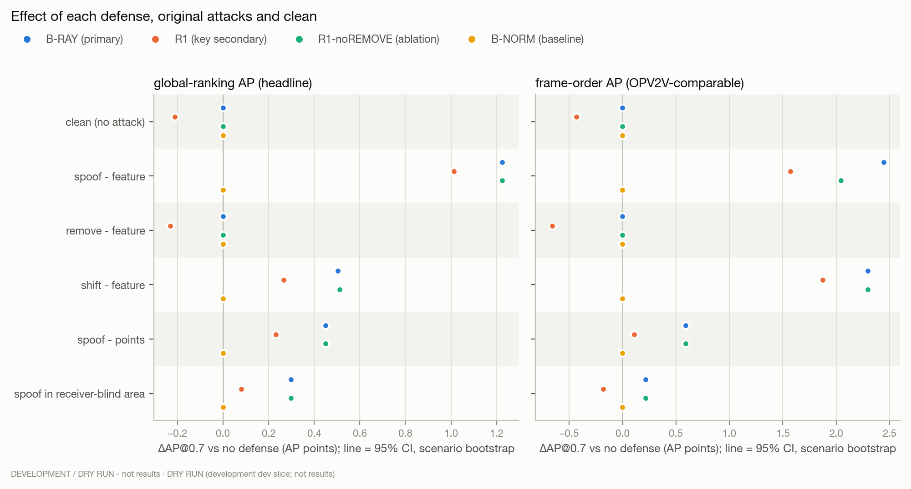

*Figure 2a. Every non-PGD condition × defense, both AP definitions, 95% CI from the scenario bootstrap. Ego-only in the table only.* Data: [`tables/02_per_family.csv`](tables/02_per_family.csv) · dark version: [`figures/02_per_family_dark.png`](figures/02_per_family_dark.png)

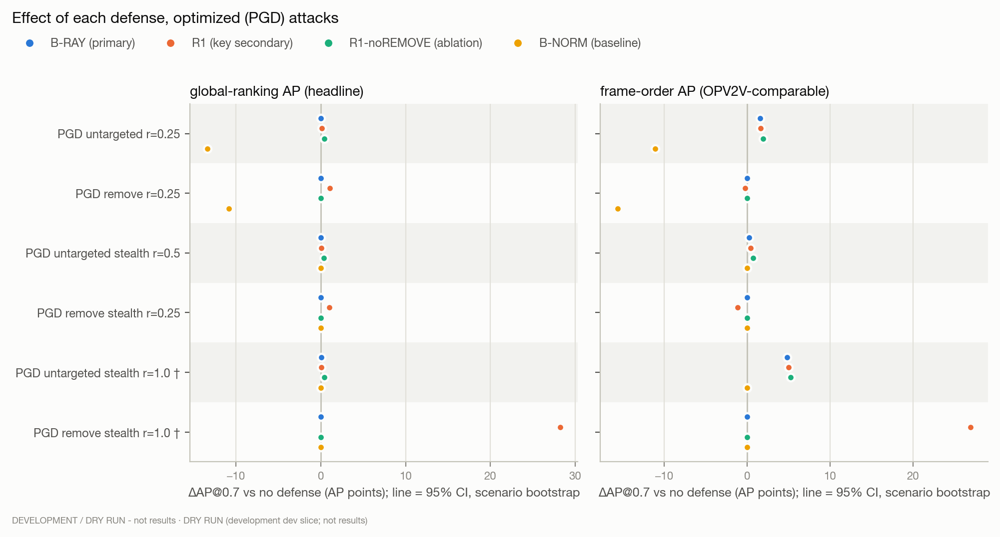

*Figure 2b. As 2a for the PGD conditions, on its own scale (PGD effects are much larger than the original attacks').* Data: [`tables/02b_per_family_pgd.csv`](tables/02b_per_family_pgd.csv) · dark version: [`figures/02b_per_family_pgd_dark.png`](figures/02b_per_family_pgd_dark.png)

**global-ranking AP (headline)** (ΔAP@0.7 in AP points, 95% CI scenario bootstrap)

| Condition | B-RAY (primary) | R1 (key secondary) | R1-noREMOVE (ablation) | B-NORM (baseline) | Ego-only |
|---|---|---|---|---|---|
| clean (no attack) | +0.00 [+0.00, +0.00] | -0.21 [-0.21, -0.21] | +0.00 [+0.00, +0.00] | +0.00 [+0.00, +0.00] | -14.34 [-14.34, -14.34] |
| spoof - feature | +1.22 [+1.22, +1.22] | +1.01 [+1.01, +1.01] | +1.22 [+1.22, +1.22] | +0.00 [+0.00, +0.00] | -13.11 [-13.11, -13.11] |
| remove - feature | +0.00 [+0.00, +0.00] | -0.23 [-0.23, -0.23] | +0.00 [+0.00, +0.00] | +0.00 [+0.00, +0.00] | -12.68 [-12.68, -12.68] |
| shift - feature | +0.50 [+0.50, +0.50] | +0.27 [+0.27, +0.27] | +0.51 [+0.51, +0.51] | +0.00 [+0.00, +0.00] | -12.23 [-12.23, -12.23] |
| spoof - points | +0.45 [+0.45, +0.45] | +0.23 [+0.23, +0.23] | +0.45 [+0.45, +0.45] | +0.00 [+0.00, +0.00] | -13.71 [-13.70, -13.70] |
| spoof in receiver-blind area | +0.30 [+0.30, +0.30] | +0.08 [+0.08, +0.08] | +0.30 [+0.30, +0.30] | +0.00 [+0.00, +0.00] | -12.46 [-12.46, -12.46] |
| PGD untargeted r=0.25 | +0.02 [+0.02, +0.02] | +0.12 [+0.12, +0.12] | +0.40 [+0.40, +0.40] | -13.37 [-13.37, -13.37] | -13.37 [-13.37, -13.37] |
| PGD remove r=0.25 | +0.00 [+0.00, +0.00] | +1.03 [+1.03, +1.03] | +0.00 [+0.00, +0.00] | -10.83 [-10.83, -10.83] | -10.83 [-10.83, -10.83] |
| PGD untargeted stealth r=0.5 | +0.00 [+0.00, +0.00] | +0.07 [+0.07, +0.07] | +0.37 [+0.37, +0.37] | +0.00 [+0.00, +0.00] | -13.32 [-13.32, -13.32] |
| PGD remove stealth r=0.25 | +0.00 [+0.00, +0.00] | +1.01 [+1.01, +1.01] | +0.00 [+0.00, +0.00] | +0.00 [+0.00, +0.00] | -10.49 [-10.49, -10.49] |
| PGD untargeted stealth r=1.0 † | +0.07 [+0.07, +0.07] | +0.08 [+0.08, +0.08] | +0.41 [+0.41, +0.41] | +0.00 [+0.00, +0.00] | -7.60 [-7.60, -7.60] |
| PGD remove stealth r=1.0 † | +0.00 [+0.00, +0.00] | +28.23 [+28.23, +28.23] | +0.00 [+0.00, +0.00] | +0.00 [+0.00, +0.00] | +33.67 [+33.67, +33.67] |

**frame-order AP (OPV2V-comparable)** (ΔAP@0.7 in AP points, 95% CI scenario bootstrap)

| Condition | B-RAY (primary) | R1 (key secondary) | R1-noREMOVE (ablation) | B-NORM (baseline) | Ego-only |
|---|---|---|---|---|---|
| clean (no attack) | +0.00 [+0.00, +0.00] | -0.43 [-0.43, -0.43] | +0.00 [+0.00, +0.00] | +0.00 [+0.00, +0.00] | -17.68 [-17.68, -17.68] |
| spoof - feature | +2.44 [+2.44, +2.44] | +1.57 [+1.57, +1.57] | +2.04 [+2.04, +2.04] | +0.00 [+0.00, +0.00] | -15.14 [-15.14, -15.14] |
| remove - feature | +0.00 [+0.00, +0.00] | -0.66 [-0.66, -0.66] | +0.00 [+0.00, +0.00] | +0.00 [+0.00, +0.00] | -15.15 [-15.15, -15.15] |
| shift - feature | +2.30 [+2.30, +2.30] | +1.88 [+1.87, +1.87] | +2.30 [+2.30, +2.30] | +0.00 [+0.00, +0.00] | -13.40 [-13.40, -13.40] |
| spoof - points | +0.59 [+0.59, +0.59] | +0.11 [+0.11, +0.11] | +0.59 [+0.59, +0.59] | +0.00 [+0.00, +0.00] | -16.57 [-16.57, -16.57] |
| spoof in receiver-blind area | +0.22 [+0.22, +0.22] | -0.18 [-0.18, -0.18] | +0.22 [+0.22, +0.22] | +0.00 [+0.00, +0.00] | -13.65 [-13.65, -13.65] |
| PGD untargeted r=0.25 | +1.61 [+1.61, +1.61] | +1.65 [+1.65, +1.65] | +1.95 [+1.95, +1.95] | -11.07 [-11.07, -11.07] | -11.07 [-11.07, -11.07] |
| PGD remove r=0.25 | +0.00 [+0.00, +0.00] | -0.21 [-0.21, -0.21] | +0.00 [+0.00, +0.00] | -15.60 [-15.59, -15.59] | -15.60 [-15.59, -15.59] |
| PGD untargeted stealth r=0.5 | +0.27 [+0.27, +0.27] | +0.43 [+0.43, +0.43] | +0.74 [+0.74, +0.74] | +0.00 [+0.00, +0.00] | -12.57 [-12.57, -12.57] |
| PGD remove stealth r=0.25 | +0.00 [+0.00, +0.00] | -1.12 [-1.12, -1.12] | +0.00 [+0.00, +0.00] | +0.00 [+0.00, +0.00] | -15.85 [-15.85, -15.85] |
| PGD untargeted stealth r=1.0 † | +4.84 [+4.84, +4.84] | +5.03 [+5.03, +5.03] | +5.27 [+5.27, +5.27] | +0.00 [+0.00, +0.00] | +4.85 [+4.85, +4.85] |
| PGD remove stealth r=1.0 † | +0.00 [+0.00, +0.00] | +26.94 [+26.94, +26.94] | +0.00 [+0.00, +0.00] | +0.00 [+0.00, +0.00] | +26.43 [+26.43, +26.43] |

## 6. Cost on clean frames

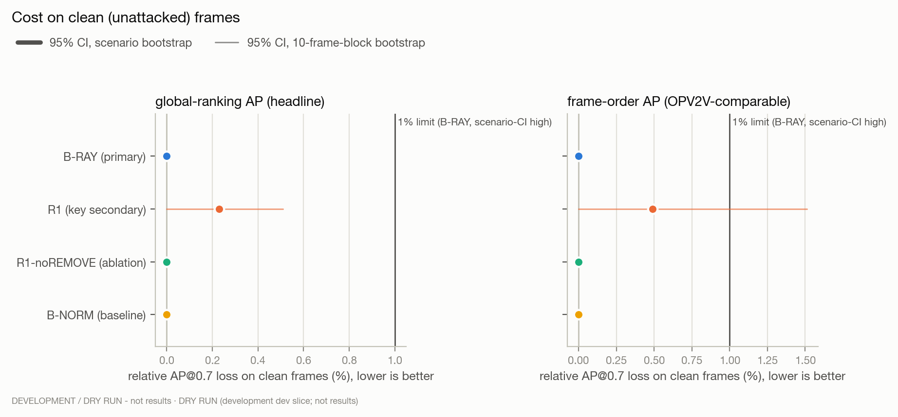

*Figure 3. Relative AP@0.7 loss on clean frames. The pre-registered success rule requires B-RAY's scenario-CI high ≤ 1% under both AP definitions.* Data: [`tables/03_clean_cost.csv`](tables/03_clean_cost.csv) · dark version: [`figures/03_clean_cost_dark.png`](figures/03_clean_cost_dark.png)

| Method | rel. loss global | 95% CI scen. (%) global | rel. loss frame | 95% CI scen. (%) frame |
|---|---|---|---|---|
| B-RAY (primary) | 0.00% | [+0.00, +0.00] | 0.00% | [+0.00, +0.00] |
| R1 (key secondary) | 0.23% | [+0.23, +0.23] | 0.49% | [+0.49, +0.49] |
| R1-noREMOVE (ablation) | 0.00% | [+0.00, +0.00] | 0.00% | [+0.00, +0.00] |
| B-NORM (baseline) | 0.00% | [+0.00, +0.00] | 0.00% | [+0.00, +0.00] |
| Ego-only | 15.53% | [+15.53, +15.53] | 20.06% | [+20.06, +20.06] |

## 7. Key secondary: R1 versus B-RAY

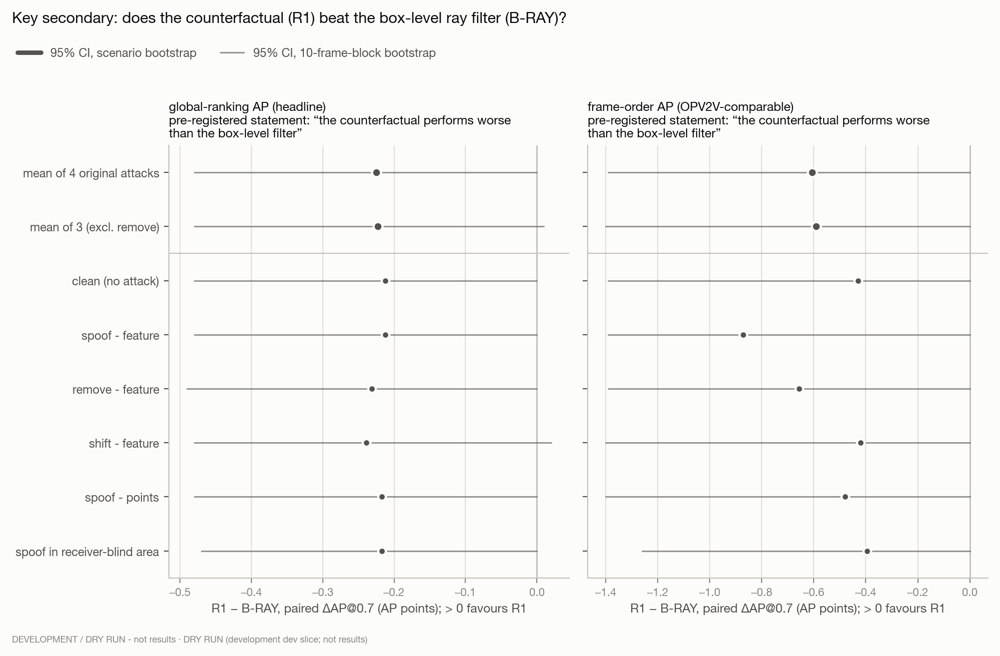

*Figure 4a. Paired difference R1 − B-RAY in ΔAP@0.7, the pre-registered means and each non-PGD condition. Each panel quotes the statement the frozen analysis emitted.* Data: [`tables/04_r1_minus_bray.csv`](tables/04_r1_minus_bray.csv) · dark version: [`figures/04_r1_minus_bray_dark.png`](figures/04_r1_minus_bray_dark.png)

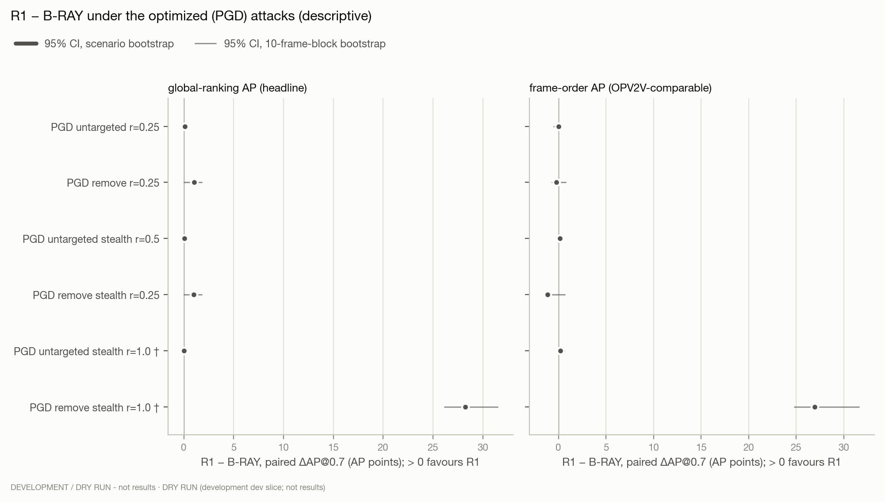

*Figure 4b. Paired difference per PGD condition (descriptive; not part of the key secondary).* Data: [`tables/04b_r1_minus_bray_pgd.csv`](tables/04b_r1_minus_bray_pgd.csv) · dark version: [`figures/04b_r1_minus_bray_pgd_dark.png`](figures/04b_r1_minus_bray_pgd_dark.png)
## 8. Optimized (PGD) feature attacks and B-NORM

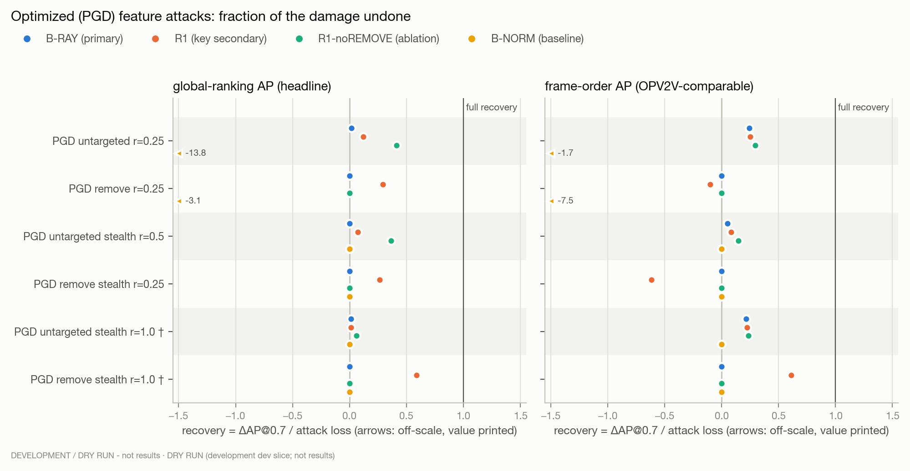

*Figure 5. Recovery = ΔAP@0.7 / attack loss per optimized-attack condition. n/a when the attack loss is < 0.005.* Data: [`tables/05_pgd_recovery.csv`](tables/05_pgd_recovery.csv) · dark version: [`figures/05_pgd_recovery_dark.png`](figures/05_pgd_recovery_dark.png)

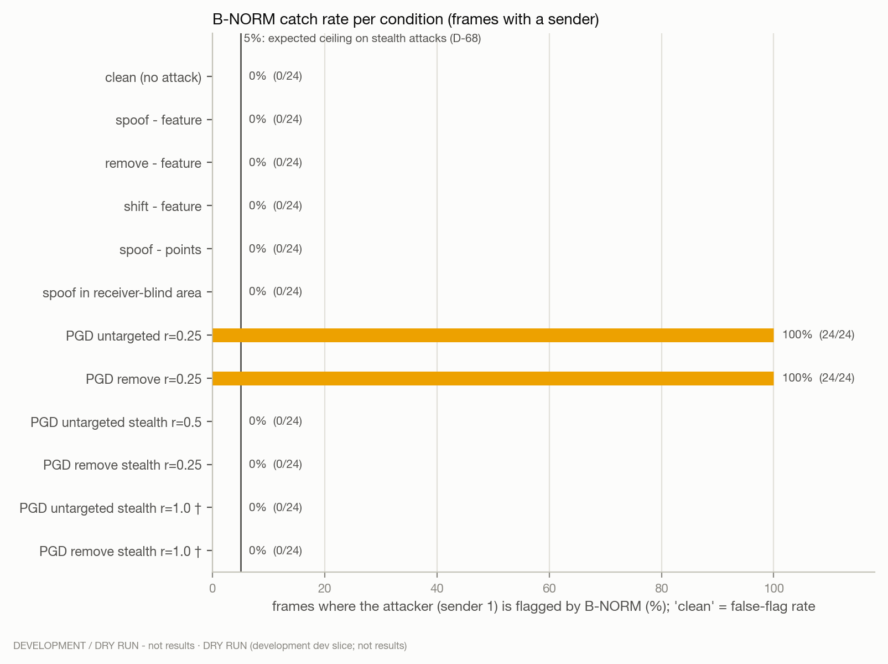

*Figure 6. Share of frames with a sender in which B-NORM flags the attacker; on 'clean' this is the false-flag rate.* Data: [`tables/06_bnorm_catch.csv`](tables/06_bnorm_catch.csv) · dark version: [`figures/06_bnorm_catch_dark.png`](figures/06_bnorm_catch_dark.png)

| Condition | attack loss global | attack loss frame | recovery B-RAY (primary) (global / frame) | recovery R1 (key secondary) (global / frame) | recovery R1-noREMOVE (ablation) (global / frame) | recovery B-NORM (baseline) (global / frame) | recovery Ego-only (global / frame) | B-NORM catch | stealth-infeasible / frames with sender | realized / applied |
|---|---|---|---|---|---|---|---|---|---|---|
| PGD untargeted r=0.25 | +0.97 | +6.60 | 0.02 / 0.24 | 0.12 / 0.25 | 0.41 / 0.30 | -13.77 / -1.68 | -13.77 / -1.68 | 100% | 0/24 | 21/24 |
| PGD remove r=0.25 | +3.51 | +2.08 | 0.00 / 0.00 | 0.29 / -0.10 | 0.00 / 0.00 | -3.09 / -7.49 | -3.09 / -7.49 | 100% | 0/24 | 12/24 |
| PGD untargeted stealth r=0.5 | +1.02 | +5.11 | 0.00 / 0.05 | 0.07 / 0.08 | 0.36 / 0.15 | 0.00 / 0.00 | -13.04 / -2.46 | 0% | 0/24 | 17/24 |
| PGD remove stealth r=0.25 | +3.85 | +1.82 | 0.00 / 0.00 | 0.26 / -0.62 | 0.00 / 0.00 | 0.00 / 0.00 | -2.73 / -8.70 | 0% | 0/24 | 14/24 |
| PGD untargeted stealth r=1.0 † | +6.73 | +22.52 | 0.01 / 0.21 | 0.01 / 0.22 | 0.06 / 0.23 | 0.00 / 0.00 | -1.13 / 0.22 | 0% | 0/24 | 23/24 |
| PGD remove stealth r=1.0 † | +48.01 | +44.11 | 0.00 / 0.00 | 0.59 / 0.61 | 0.00 / 0.00 | 0.00 / 0.00 | 0.70 / 0.60 | 0% | 0/24 | 24/24 |

**Expected outcomes, checked descriptively** (rules stated in the preregistration before any PGD run; not criteria):

| Condition | B-RAY ≈ 0 (point recovery < 0.10 under both AP definitions) | R1 > 0 (R1 dAP@0.7 scenario-CI low > 0 under both AP definitions) | B-NORM ≤ 5% (sender-1 flag rate over attacked frames <= 0.05) |
|---|---|---|---|
| PGD untargeted r=0.25 | no | not applicable | not applicable |
| PGD remove r=0.25 | yes | no | not applicable |
| PGD untargeted stealth r=0.5 | yes | not applicable | yes |
| PGD remove stealth r=0.25 | yes | no | yes |
| PGD untargeted stealth r=1.0 † | no | not applicable | yes |
| PGD remove stealth r=1.0 † | yes | yes | yes |

## 9. Attack strength and realized-only effects

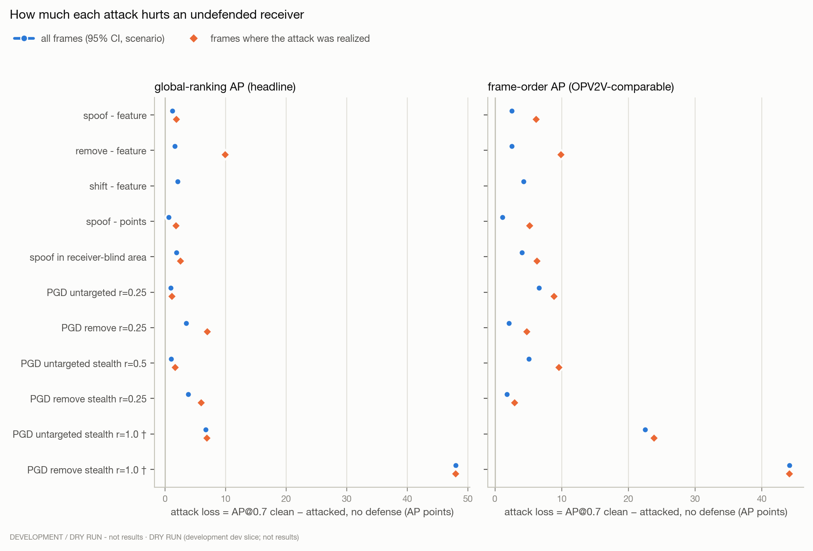

*Figure 7. Attack loss per condition over all frames (with CI) and over the frames where the attack was realized.* Data: [`tables/07_attack_strength.csv`](tables/07_attack_strength.csv) · dark version: [`figures/07_attack_strength_dark.png`](figures/07_attack_strength_dark.png)

**Realized frames only, global-ranking AP (headline)** (ΔAP@0.7 in AP points, recovery in brackets)

| Condition | realized frames | attack loss | B-RAY (primary) ΔAP (recovery) | R1 (key secondary) ΔAP (recovery) | R1-noREMOVE (ablation) ΔAP (recovery) | B-NORM (baseline) ΔAP (recovery) | Ego-only ΔAP (recovery) |
|---|---|---|---|---|---|---|---|
| spoof - feature | 14 | +1.91 | +1.91 (1.00) | +1.60 (0.84) | +1.91 (1.00) | +0.00 (0.00) | -11.81 (-6.17) |
| remove - feature | 1 | +9.92 | +0.00 (0.00) | +0.00 (0.00) | +0.00 (0.00) | +0.00 (0.00) | -17.36 (-1.75) |
| shift - feature | 0 | n/a | n/a | n/a | n/a | n/a | n/a |
| spoof - points | 7 | +1.79 | +1.28 (0.71) | +0.70 (0.39) | +1.28 (0.71) | +0.00 (0.00) | -9.60 (-5.36) |
| spoof in receiver-blind area | 16 | +2.54 | +0.41 (0.16) | +0.11 (0.04) | +0.41 (0.16) | +0.00 (0.00) | -11.74 (-4.63) |
| PGD untargeted r=0.25 | 21 | +1.12 | +0.02 (0.02) | +0.15 (0.13) | +0.46 (0.41) | -12.58 (-11.26) | -12.58 (-11.26) |
| PGD remove r=0.25 | 12 | +7.02 | +0.00 (0.00) | +2.25 (0.32) | +0.00 (0.00) | -6.00 (-0.85) | -6.00 (-0.85) |
| PGD untargeted stealth r=0.5 | 17 | +1.68 | +0.00 (0.00) | +0.13 (0.08) | +0.51 (0.30) | +0.00 (0.00) | -10.83 (-6.44) |
| PGD remove stealth r=0.25 | 14 | +5.97 | +0.00 (0.00) | +1.89 (0.32) | +0.00 (0.00) | +0.00 (0.00) | -8.93 (-1.50) |
| PGD untargeted stealth r=1.0 † | 23 | +6.91 | +0.07 (0.01) | +0.08 (0.01) | +0.42 (0.06) | +0.00 (0.00) | -7.62 (-1.10) |
| PGD remove stealth r=1.0 † | 24 | +48.01 | +0.00 (0.00) | +28.23 (0.59) | +0.00 (0.00) | +0.00 (0.00) | +33.67 (0.70) |

**Realized frames only, frame-order AP (OPV2V-comparable)** (ΔAP@0.7 in AP points, recovery in brackets)

| Condition | realized frames | attack loss | B-RAY (primary) ΔAP (recovery) | R1 (key secondary) ΔAP (recovery) | R1-noREMOVE (ablation) ΔAP (recovery) | B-NORM (baseline) ΔAP (recovery) | Ego-only ΔAP (recovery) |
|---|---|---|---|---|---|---|---|
| spoof - feature | 14 | +6.15 | +5.74 (0.93) | +3.36 (0.55) | +5.01 (0.81) | +0.00 (0.00) | -12.47 (-2.03) |
| remove - feature | 1 | +9.92 | +0.00 (0.00) | +0.00 (0.00) | +0.00 (0.00) | +0.00 (0.00) | -17.36 (-1.75) |
| shift - feature | 0 | n/a | n/a | n/a | n/a | n/a | n/a |
| spoof - points | 7 | +5.20 | +3.31 (0.64) | +0.17 (0.03) | +3.31 (0.64) | +0.00 (0.00) | -9.15 (-1.76) |
| spoof in receiver-blind area | 16 | +6.31 | +0.33 (0.05) | -0.16 (-0.03) | +0.33 (0.05) | +0.00 (0.00) | -10.35 (-1.64) |
| PGD untargeted r=0.25 | 21 | +8.83 | +2.24 (0.25) | +2.24 (0.25) | +2.63 (0.30) | -8.60 (-0.97) | -8.60 (-0.97) |
| PGD remove r=0.25 | 12 | +4.77 | +0.00 (0.00) | +0.95 (0.20) | +0.00 (0.00) | -10.73 (-2.25) | -10.73 (-2.25) |
| PGD untargeted stealth r=0.5 | 17 | +9.58 | +0.52 (0.06) | +0.56 (0.06) | +1.28 (0.13) | +0.00 (0.00) | -8.32 (-0.87) |
| PGD remove stealth r=0.25 | 14 | +2.95 | +0.00 (0.00) | -0.25 (-0.08) | +0.00 (0.00) | +0.00 (0.00) | -14.81 (-5.02) |
| PGD untargeted stealth r=1.0 † | 23 | +23.83 | +5.02 (0.21) | +5.21 (0.22) | +5.48 (0.23) | +0.00 (0.00) | +5.68 (0.24) |
| PGD remove stealth r=1.0 † | 24 | +44.11 | +0.00 (0.00) | +26.94 (0.61) | +0.00 (0.00) | +0.00 (0.00) | +26.43 (0.60) |

## 10. How the defenses act

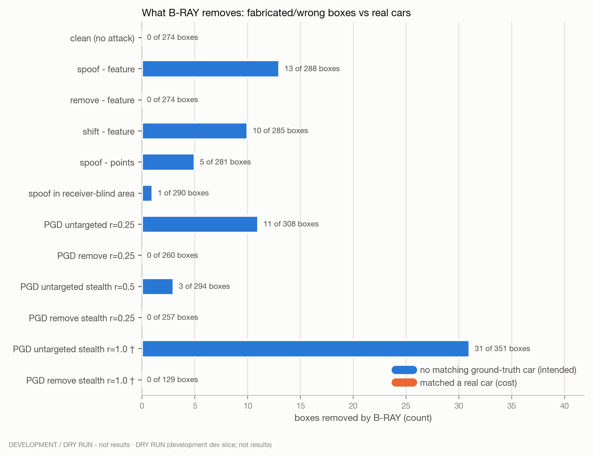

*Figure 8. Boxes B-RAY removed, split by whether they matched a real car.* Data: [`tables/08_bray_boxes.csv`](tables/08_bray_boxes.csv) · dark version: [`figures/08_bray_boxes_dark.png`](figures/08_bray_boxes_dark.png)

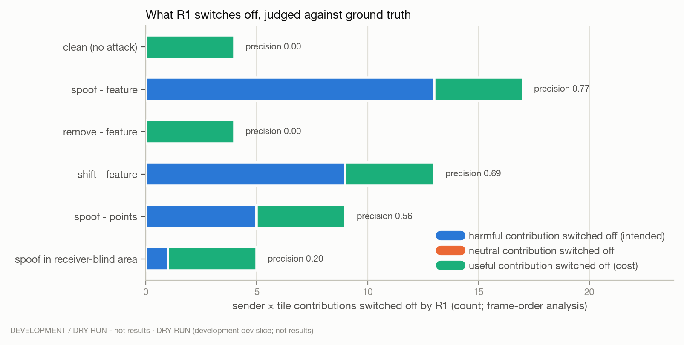

*Figure 9. Contributions (sender × 6.4 m tile) R1 switched off, by their ground-truth label.* Data: [`tables/09_r1_units.csv`](tables/09_r1_units.csv) · dark version: [`figures/09_r1_units_dark.png`](figures/09_r1_units_dark.png)

## 11. By number of cars

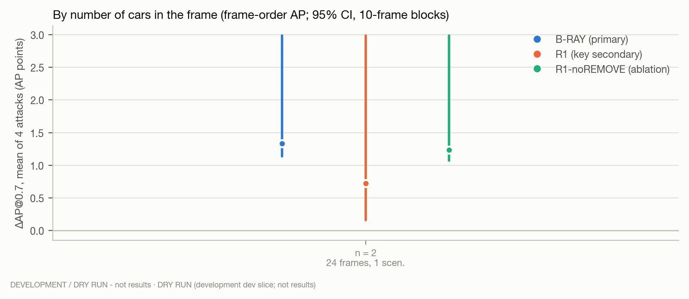

*Figure 10. Mean ΔAP@0.7 over the 4 original attacks per agent count (frozen v2 analysis, frame-order AP).* Data: [`tables/10_by_agents.csv`](tables/10_by_agents.csv) · dark version: [`figures/10_by_agents_dark.png`](figures/10_by_agents_dark.png)

## 12. Interpretation (AUTHOR)

<!-- AUTHOR: write this section only after reading sections 2-11. Keep to what the numbers support. -->
*To be written by the authors.* Suggested questions, answered from the tables above:

1. Does the pre-registered verdict hold under both AP definitions, and how large is the headline effect in AP points?
2. Is the clean cost within the 1% limit, and what does B-RAY remove that it should not (section 10)?
3. Does R1 add anything over B-RAY (section 7)? Quote the pre-registered statement as written.
4. Which attacks are not recovered by any method (spoof in blind areas, stealth PGD), and is that the expected identifiability limit?
5. How do the final-test numbers compare with the development numbers (blocks T and H), reported separately?

## 13. Scope, labelling and deviations

**Scope limits (pre-registered).** D-54 and D-63 (single attacker; random placement for the E4 families; spoof_blind bypass; ray-consistent / low-ray spoofs; B-RAY cannot restore removed objects; receiver sensor trusted; CARLA LiDAR; method chosen on exposed H), plus: PGD is white-box on this checkpoint with budgets relative to its clean H feature scale; B-NORM's threshold is fitted on clean H

**Labelling.** Test numbers are the one-time final test. All E0-E5a numbers (blocks T and H) are development or held-out-but-exposed and are reported separately. v2 is the governing pre-registration.

**Reporting rules (D-69).** Headline AP: global-ranking AP (D-64). absolute dAP in AP points next to every recovery. Scope: R1 cannot verify removals in receiver-blind regions (a removed object the receiver cannot see is UNKNOWN = keep).

**Deviation D-71 (stream bug fix, no method change).** runners/v3_2_stream.py: v3_extra = the v3.1 v3_extra with the copy loop replaced by copy_mabs: a record without 'mabs' is skipped after asserting ledger reason == 'stealth_infeasible' (any other cause still fails). Same reading as the frozen v3_analyze.frames_test ('if "mabs" in rec') and cond_of (no 'cands' -> clean, not applied). install() = v3.1 install() + v3_extra and preregistration swapped; v3/v3.1 frozen files byte-identical Crashed attempt: KeyError 'mabs' at runners/v3_1_stream.py:73 on frame 1-3 of the first scenario, 20:04:10; results written before the fix: none (cache/ and v3extra/ empty; results are written per completed scenario). Seen before the fix: the frame-0 timing line of 2021_08_18_19_48_05 (6.4 s + 22.8 s) and the fact that >= 1 stealth condition was infeasible on >= 1 of its frames 1-3 (condition and count unknown); no AP, loss, flag or recovery value.

## Appendix: absolute AP@0.7

**global-ranking AP (headline)**

| Condition | No defense | B-RAY (primary) | R1 (key secondary) | R1-noREMOVE (ablation) | B-NORM (baseline) | Ego-only |
|---|---|---|---|---|---|---|
| clean (no attack) | 0.9235 | 0.9235 | 0.9214 | 0.9235 | 0.9235 | 0.7801 |
| spoof - feature | 0.9113 | 0.9235 | 0.9214 | 0.9235 | 0.9113 | 0.7801 |
| remove - feature | 0.9070 | 0.9070 | 0.9047 | 0.9070 | 0.9070 | 0.7801 |
| shift - feature | 0.9024 | 0.9075 | 0.9051 | 0.9075 | 0.9024 | 0.7801 |
| spoof - points | 0.9172 | 0.9217 | 0.9195 | 0.9217 | 0.9172 | 0.7801 |
| spoof in receiver-blind area | 0.9047 | 0.9077 | 0.9055 | 0.9077 | 0.9047 | 0.7801 |
| PGD untargeted r=0.25 | 0.9138 | 0.9140 | 0.9150 | 0.9178 | 0.7801 | 0.7801 |
| PGD remove r=0.25 | 0.8884 | 0.8884 | 0.8987 | 0.8884 | 0.7801 | 0.7801 |
| PGD untargeted stealth r=0.5 | 0.9133 | 0.9133 | 0.9140 | 0.9170 | 0.9133 | 0.7801 |
| PGD remove stealth r=0.25 | 0.8850 | 0.8850 | 0.8951 | 0.8850 | 0.8850 | 0.7801 |
| PGD untargeted stealth r=1.0 † | 0.8562 | 0.8569 | 0.8570 | 0.8603 | 0.8562 | 0.7801 |
| PGD remove stealth r=1.0 † | 0.4434 | 0.4434 | 0.7257 | 0.4434 | 0.4434 | 0.7801 |

**frame-order AP (OPV2V-comparable)**

| Condition | No defense | B-RAY (primary) | R1 (key secondary) | R1-noREMOVE (ablation) | B-NORM (baseline) | Ego-only |
|---|---|---|---|---|---|---|
| clean (no attack) | 0.8811 | 0.8811 | 0.8768 | 0.8811 | 0.8811 | 0.7043 |
| spoof - feature | 0.8557 | 0.8802 | 0.8715 | 0.8762 | 0.8557 | 0.7043 |
| remove - feature | 0.8559 | 0.8559 | 0.8493 | 0.8559 | 0.8559 | 0.7043 |
| shift - feature | 0.8383 | 0.8613 | 0.8571 | 0.8613 | 0.8383 | 0.7043 |
| spoof - points | 0.8700 | 0.8759 | 0.8711 | 0.8759 | 0.8700 | 0.7043 |
| spoof in receiver-blind area | 0.8408 | 0.8430 | 0.8390 | 0.8430 | 0.8408 | 0.7043 |
| PGD untargeted r=0.25 | 0.8151 | 0.8312 | 0.8316 | 0.8346 | 0.7043 | 0.7043 |
| PGD remove r=0.25 | 0.8603 | 0.8603 | 0.8581 | 0.8603 | 0.7043 | 0.7043 |
| PGD untargeted stealth r=0.5 | 0.8300 | 0.8327 | 0.8342 | 0.8374 | 0.8300 | 0.7043 |
| PGD remove stealth r=0.25 | 0.8629 | 0.8629 | 0.8516 | 0.8629 | 0.8629 | 0.7043 |
| PGD untargeted stealth r=1.0 † | 0.6559 | 0.7043 | 0.7061 | 0.7085 | 0.6559 | 0.7043 |
| PGD remove stealth r=1.0 † | 0.4400 | 0.4400 | 0.7094 | 0.4400 | 0.4400 | 0.7043 |

