# MINT unseen-town evaluation (OPV2V Culver City): results report

> **Status: CULVER CITY (held-out domain shift)**
> Source: CULVER CITY (held-out domain shift; secondary, D-72; unseen town, simulated sensor)
>
> **Unseen town, simulated sensor.** OPV2V Culver City: simulated (CARLA) 64-beam LiDAR, the same sensor model as the OPV2V test; a digital town modelled on the layout of the real city of Culver City; unseen during detector training and during all MINT development. NOT real-sensor data.
>
> **Role.** SECONDARY held-out domain-shift evaluation. The OPV2V test (runs/20261024-E5v3, preregistration_v3_2.json) stays the primary, one-time final test. Culver City results are reported separately and never pooled with the test. The primary result is the OPV2V final test (`runs/20261024-E5v3/report/report.md`).

Generated 2026-10-27T07:29:56+05:30 by `runners/culver_report.py` (the `src/mint/report` pipeline, unchanged). Every number in this report is copied from the analysis outputs listed below; nothing is recomputed. Sections marked **AUTHOR** are left for the authors to write after reading the results.

**Few scenarios.** 4 scenarios only: the scenario bootstrap has at most 35 distinct resamples (multisets of 4 from 4), so scenario CIs and p-values are coarse; 10-frame CIs are reported next to them but are not the pre-registered primary CI. frames have n <= 3; per-agent-count strata have 2 scenarios each, so only 10-frame CIs exist there (frozen MIN_SCEN_FOR_SCEN_BOOT = 5).

| Provenance | |
|---|---|
| `e5_v3.json` | `runs/20261026-CULVER/e5_v3.json` · sha256 `fa6325dee8058bac…` |
| `e5_test.json` | `runs/20261026-CULVER/e5_test.json` · sha256 `5d4481334d983c9c…` |
| `preregistration` | `runs/20261024-E5/preregistration_v3_2.json` · sha256 `8756868def368e85…` |
| Repository HEAD | `3d79603e9648ebe9e86f47d12a7a43b0f4df559b` |
| Frozen code commit (preregistration) | `c883753f91c75e707d5df5fce8757851fad494de` |
| Preregistration version | v3.2 (supersedes v3.1 runs/20261024-E5/preregistration_v3_1.json only by D-71; v1, v2, v3 and v3.1 kept unchanged) |
| Scenarios / frames | 4 / 550 (agents per frame: {'1': 72, '2': 355, '3': 123}) |

## 1. What was tested

**Defenses compared** (pre-registered comparison set): no defense; ego-only; B-NORM (D-66, new); B-RAY (primary); R1 (key secondary); R1-noREMOVE (ablation); oracle bounds as v2 (frozen e5_analyze).

**Conditions** (12): clean (no attack); spoof - feature; remove - feature; shift - feature; spoof - points; spoof in receiver-blind area; PGD untargeted r=0.25; PGD remove r=0.25; PGD untargeted stealth r=0.5; PGD remove stealth r=0.25; PGD untargeted stealth r=1.0 †; PGD remove stealth r=1.0 †.

† pgd_remove_stealth@r1.0, pgd_untargeted_stealth@r1.0: strong-attack level, added after seeing block-H development results (D-70, secondary; never used for a criterion).

**Metrics.** ΔAP@0.7 = AP of a defense minus AP with no defense on the same frames, in AP points (×100). Recovery = ΔAP / attack loss. Clean cost = relative AP@0.7 loss on unattacked frames. Every statistic is computed under two AP definitions: global-ranking AP (headline) and frame-order AP (OPV2V-comparable).

**Pre-registered rule (D-64).** every primary and key-secondary statistic is computed under both definitions with the same bootstrap (seed 0, 2000 resamples, scenario and 10-frame). The v2 success rule (B-RAY Holm-rejected in the co-test with R1 vs no defense on the scenario bootstrap, and B-RAY clean relative loss scenario-CI high <= 1%) is evaluated separately per AP definition, Holm within each definition. A success/robustness claim requires a pass under BOTH. Headline numbers are quoted with global-ranking AP; frame-order AP is reported for comparability with OPV2V papers. If the two disagree the report states 'AP-definition-dependent'. R1 - B-RAY (statement by scenario CI, v2 wording) is reported under both, side by side.

**Outcome wording.** Success: only if the v2 rule passes under both AP definitions (D-64); headline in global-ranking AP. Disagreement: report 'AP-definition-dependent'. Failure: report as the result; no rescue analysis presented as confirmatory.

**Parameters.** σ_k, B-NORM τ_k, attack levels, seeds and every method are those of `preregistration_v3_2.json`, reused unchanged (same checkpoint and sensor); nothing was fitted or tuned on Culver City.

## 2. Procedural checks

| Check | Detail | Passed |
|---|---|---|
| Completeness (scenarios, frames) | 4/4 scenarios, 550/550 frames | yes |
| Frame-order v3 = frozen v2 analysis | 4 statistics, point and scenario CI | yes |
| NumPy AP vs OpenCOOD AP | max abs. difference 1.8e-13 | yes |
| Compose checks identical (all scenarios) | 4 scenarios | yes |

**Clean-detector sanity check (planned; first scenario only, before any MINT method or attack ran on Culver City).** Scenario `2021_09_03_09_32_17` (90 frames, agents {'2': 90}), OpenCOOD inference path: AP@0.7 frame-order (OpenCOOD default) **0.9168**, global sort 0.9379; published Culver City AP@0.7 (all scenarios, frame order) 0.735; stop rule AP@0.7 < 0.6: passed.

## 3. Pre-registered rule, reported descriptively (secondary evaluation)

The v3.2 success rule is applied unchanged and reported **descriptively**; it does not re-open the OPV2V test verdict.

**AP-definition-dependent.** v2 rule under global-ranking AP: does not pass; under frame-order AP: passes.

| AP definition | B-RAY ΔAP | B-RAY p (1-sided) | B-RAY Holm reject | R1 ΔAP | R1 p | R1 Holm reject | B-RAY clean loss CI (%) | clean CI high ≤ 1% | v2 rule passes |
|---|---|---|---|---|---|---|---|---|---|
| global-ranking AP (headline) | +0.05 | 0.1209 | no | +0.32 | 0.0005 | yes | [+0.08, +0.19] | yes | no |
| frame-order AP (OPV2V-comparable) | +0.54 | 0.0005 | yes | +0.40 | 0.0005 | yes | [-0.18, +0.07] | yes | yes |

**Key secondary (R1 − B-RAY), statements emitted by the frozen analysis:**

| AP definition | R1 − B-RAY (pts) | 95% CI scen. | 95% CI 10-frame | Pre-registered statement |
|---|---|---|---|---|
| global-ranking AP (headline) | +0.27 | [+0.12, +0.48] | [+0.16, +0.37] | “the counterfactual improves over the box-level filter” |
| frame-order AP (OPV2V-comparable) | -0.14 | [-0.40, +0.19] | [-0.32, +0.06] | “the counterfactual's benefit over a box-level filter is not established” |

The key secondary is **AP-definition-dependent** (the two definitions give different statements).

## 4. Headline: mean ΔAP@0.7 over the 4 original attacks

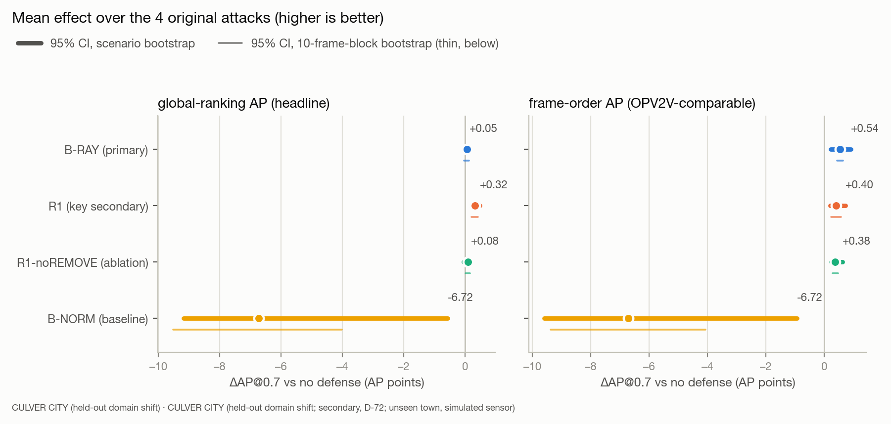

*Figure 1. Each defense's mean change in AP@0.7 against no defense, over spoof/remove/shift (feature) and spoof (points). Dot = point estimate; thick line = 95% CI from the scenario bootstrap (the pre-registered primary CI); thin line = 10-frame-block bootstrap. Ego-only is far off-scale and is listed in the table only.* Data: [`tables/01_headline.csv`](tables/01_headline.csv) · dark version: [`figures/01_headline_dark.png`](figures/01_headline_dark.png)

| Method | ΔAP@0.7 global | 95% CI scen. global | 95% CI 10-frame global | ΔAP@0.7 frame | 95% CI scen. frame | 95% CI 10-frame frame |
|---|---|---|---|---|---|---|
| B-RAY (primary) | +0.05 | [-0.03, +0.13] | [-0.03, +0.13] | +0.54 | [+0.22, +0.92] | [+0.44, +0.64] |
| R1 (key secondary) | +0.32 | [+0.21, +0.48] | [+0.21, +0.42] | +0.40 | [+0.21, +0.73] | [+0.24, +0.58] |
| R1-noREMOVE (ablation) | +0.08 | [-0.05, +0.18] | [+0.01, +0.16] | +0.38 | [+0.23, +0.63] | [+0.29, +0.48] |
| B-NORM (baseline) | -6.72 | [-9.17, -0.57] | [-9.51, -4.01] | -6.72 | [-9.59, -0.93] | [-9.37, -4.07] |
| Ego-only | -18.36 | [-23.17, -14.57] | [-20.66, -16.11] | -20.81 | [-25.17, -16.70] | [-23.22, -18.57] |

## 5. Every attack condition

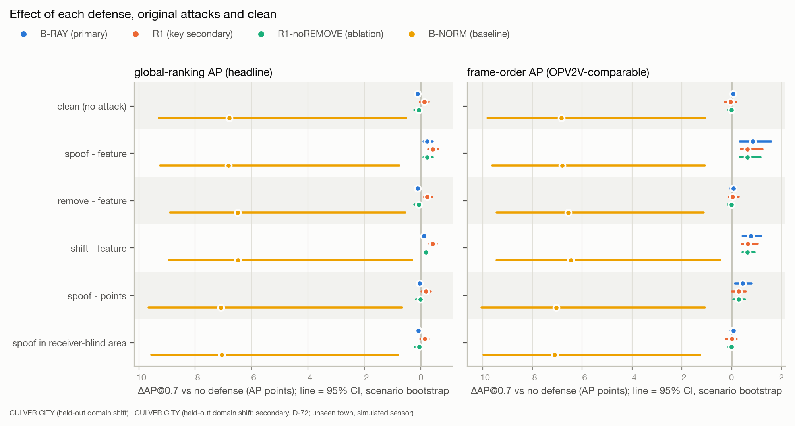

*Figure 2a. Every non-PGD condition × defense, both AP definitions, 95% CI from the scenario bootstrap. Ego-only in the table only.* Data: [`tables/02_per_family.csv`](tables/02_per_family.csv) · dark version: [`figures/02_per_family_dark.png`](figures/02_per_family_dark.png)

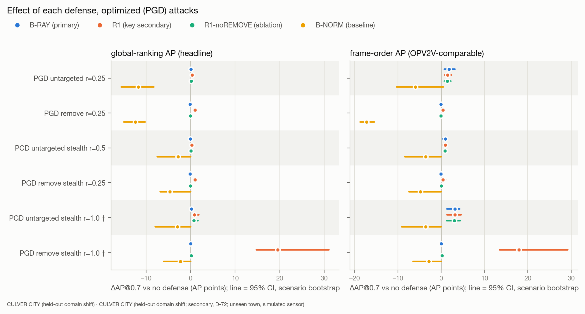

*Figure 2b. As 2a for the PGD conditions, on its own scale (PGD effects are much larger than the original attacks').* Data: [`tables/02b_per_family_pgd.csv`](tables/02b_per_family_pgd.csv) · dark version: [`figures/02b_per_family_pgd_dark.png`](figures/02b_per_family_pgd_dark.png)

**global-ranking AP (headline)** (ΔAP@0.7 in AP points, 95% CI scenario bootstrap)

| Condition | B-RAY (primary) | R1 (key secondary) | R1-noREMOVE (ablation) | B-NORM (baseline) | Ego-only |
|---|---|---|---|---|---|
| clean (no attack) | -0.10 [-0.15, -0.06] | +0.13 [-0.02, +0.29] | -0.07 [-0.22, -0.00] | -6.79 [-9.29, -0.52] | -19.38 [-24.10, -15.65] |
| spoof - feature | +0.23 [+0.10, +0.42] | +0.43 [+0.29, +0.62] | +0.23 [+0.10, +0.43] | -6.82 [-9.24, -0.76] | -18.23 [-23.06, -14.37] |
| remove - feature | -0.10 [-0.15, -0.06] | +0.23 [+0.12, +0.40] | -0.07 [-0.22, -0.00] | -6.49 [-8.89, -0.55] | -18.59 [-23.30, -14.87] |
| shift - feature | +0.12 [+0.03, +0.18] | +0.42 [+0.31, +0.57] | +0.19 [+0.10, +0.25] | -6.48 [-8.94, -0.31] | -17.41 [-22.39, -13.70] |
| spoof - points | -0.04 [-0.10, +0.01] | +0.19 [+0.03, +0.35] | -0.01 [-0.16, +0.06] | -7.09 [-9.65, -0.66] | -19.22 [-23.91, -15.45] |
| spoof in receiver-blind area | -0.07 [-0.14, -0.03] | +0.14 [-0.01, +0.29] | -0.06 [-0.20, +0.01] | -7.05 [-9.55, -0.80] | -17.93 [-22.65, -14.00] |
| PGD untargeted r=0.25 | +0.03 [-0.11, +0.11] | +0.31 [+0.16, +0.43] | +0.12 [-0.02, +0.22] | -11.79 [-15.54, -8.25] | -14.03 [-20.99, -8.25] |
| PGD remove r=0.25 | -0.12 [-0.20, -0.06] | +0.97 [+0.73, +1.42] | -0.08 [-0.23, -0.01] | -12.38 [-14.95, -10.27] | -14.63 [-20.41, -10.27] |
| PGD untargeted stealth r=0.5 | -0.06 [-0.15, -0.00] | +0.27 [+0.18, +0.41] | +0.08 [+0.05, +0.14] | -2.86 [-7.51, +0.00] | -14.67 [-21.33, -8.17] |
| PGD remove stealth r=0.25 | -0.12 [-0.22, -0.06] | +0.96 [+0.70, +1.41] | -0.07 [-0.22, +0.00] | -4.68 [-6.84, +0.00] | -15.00 [-20.40, -10.38] |
| PGD untargeted stealth r=1.0 † | +0.18 [+0.02, +0.34] | +0.88 [+0.47, +1.81] | +0.69 [+0.32, +1.63] | -2.97 [-7.92, +0.00] | -5.68 [-14.66, +3.83] |
| PGD remove stealth r=1.0 † | -0.03 [-0.08, +0.01] | +19.53 [+14.78, +31.02] | +0.09 [+0.04, +0.17] | -2.29 [-6.08, +0.00] | +20.44 [+12.09, +36.44] |

**frame-order AP (OPV2V-comparable)** (ΔAP@0.7 in AP points, 95% CI scenario bootstrap)

| Condition | B-RAY (primary) | R1 (key secondary) | R1-noREMOVE (ablation) | B-NORM (baseline) | Ego-only |
|---|---|---|---|---|---|
| clean (no attack) | +0.06 [-0.05, +0.13] | -0.04 [-0.26, +0.19] | -0.02 [-0.14, +0.06] | -6.84 [-9.81, -1.07] | -22.66 [-27.39, -18.45] |
| spoof - feature | +0.86 [+0.32, +1.58] | +0.63 [+0.38, +1.24] | +0.63 [+0.33, +1.15] | -6.81 [-9.61, -1.07] | -20.28 [-24.93, -16.17] |
| remove - feature | +0.07 [-0.05, +0.15] | +0.04 [-0.10, +0.28] | -0.01 [-0.15, +0.07] | -6.56 [-9.44, -1.12] | -21.70 [-26.33, -17.50] |
| shift - feature | +0.78 [+0.44, +1.18] | +0.65 [+0.40, +1.04] | +0.62 [+0.44, +0.92] | -6.46 [-9.43, -0.47] | -19.62 [-24.00, -15.50] |
| spoof - points | +0.43 [+0.14, +0.80] | +0.28 [+0.01, +0.57] | +0.29 [+0.07, +0.54] | -7.05 [-10.04, -1.08] | -21.65 [-26.14, -17.48] |
| spoof in receiver-blind area | +0.07 [-0.04, +0.16] | +0.01 [-0.23, +0.20] | -0.00 [-0.13, +0.08] | -7.11 [-9.97, -1.27] | -19.92 [-24.83, -15.62] |
| PGD untargeted r=0.25 | +1.80 [+0.76, +3.17] | +1.46 [+0.80, +2.32] | +1.39 [+0.73, +2.18] | -5.94 [-10.27, +0.43] | -8.64 [-17.13, +0.43] |
| PGD remove r=0.25 | -0.07 [-0.15, -0.01] | +0.40 [+0.24, +0.92] | -0.05 [-0.18, +0.02] | -17.20 [-18.70, -15.46] | -19.90 [-24.76, -15.46] |
| PGD untargeted stealth r=0.5 | +0.95 [+0.33, +1.41] | +0.94 [+0.45, +1.36] | +0.88 [+0.40, +1.24] | -3.59 [-8.39, +0.00] | -11.66 [-20.48, -1.68] |
| PGD remove stealth r=0.25 | -0.07 [-0.19, -0.00] | +0.41 [+0.25, +0.98] | -0.03 [-0.19, +0.09] | -4.82 [-7.45, +0.00] | -20.16 [-24.74, -15.56] |
| PGD untargeted stealth r=1.0 † | +3.14 [+1.33, +4.25] | +3.14 [+1.32, +4.56] | +3.03 [+1.28, +4.40] | -3.60 [-9.11, +0.00] | +4.99 [-8.80, +17.01] |
| PGD remove stealth r=1.0 † | +0.02 [-0.06, +0.11] | +17.93 [+13.52, +29.19] | +0.18 [+0.10, +0.31] | -2.88 [-6.48, +0.00] | +14.24 [+6.08, +31.35] |

## 6. Cost on clean frames

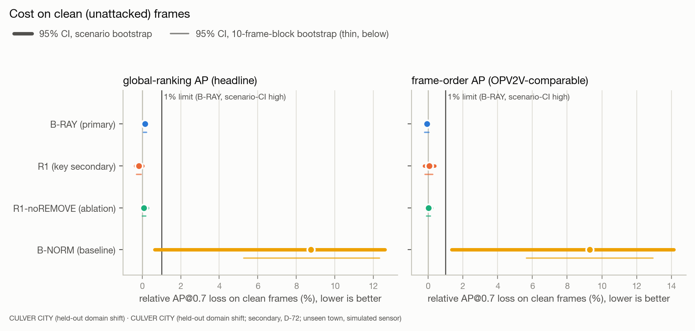

*Figure 3. Relative AP@0.7 loss on clean frames. The pre-registered success rule requires B-RAY's scenario-CI high ≤ 1% under both AP definitions.* Data: [`tables/03_clean_cost.csv`](tables/03_clean_cost.csv) · dark version: [`figures/03_clean_cost_dark.png`](figures/03_clean_cost_dark.png)

| Method | rel. loss global | 95% CI scen. (%) global | rel. loss frame | 95% CI scen. (%) frame |
|---|---|---|---|---|
| B-RAY (primary) | 0.14% | [+0.08, +0.19] | -0.07% | [-0.18, +0.07] |
| R1 (key secondary) | -0.17% | [-0.35, +0.03] | 0.06% | [-0.23, +0.37] |
| R1-noREMOVE (ablation) | 0.09% | [+0.00, +0.27] | 0.02% | [-0.09, +0.20] |
| B-NORM (baseline) | 8.77% | [+0.64, +12.61] | 9.30% | [+1.35, +14.13] |
| Ego-only | 25.02% | [+20.28, +29.37] | 30.79% | [+25.28, +35.77] |

## 7. Key secondary: R1 versus B-RAY

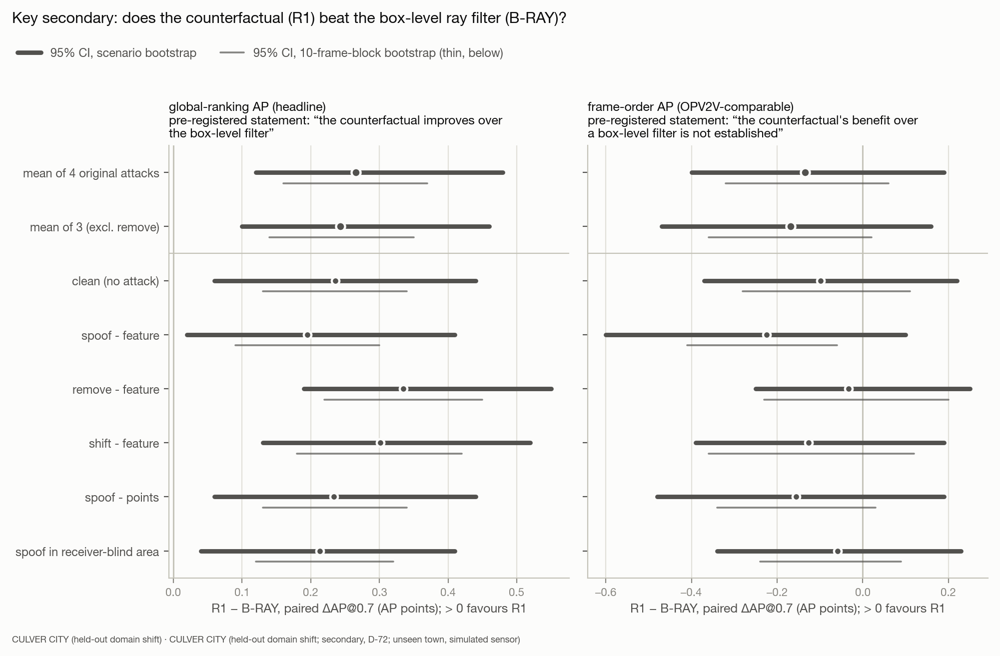

*Figure 4a. Paired difference R1 − B-RAY in ΔAP@0.7, the pre-registered means and each non-PGD condition. Each panel quotes the statement the frozen analysis emitted.* Data: [`tables/04_r1_minus_bray.csv`](tables/04_r1_minus_bray.csv) · dark version: [`figures/04_r1_minus_bray_dark.png`](figures/04_r1_minus_bray_dark.png)

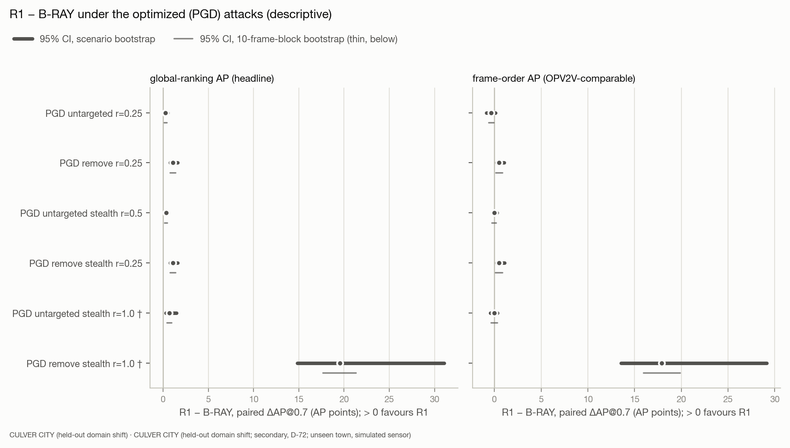

*Figure 4b. Paired difference per PGD condition (descriptive; not part of the key secondary).* Data: [`tables/04b_r1_minus_bray_pgd.csv`](tables/04b_r1_minus_bray_pgd.csv) · dark version: [`figures/04b_r1_minus_bray_pgd_dark.png`](figures/04b_r1_minus_bray_pgd_dark.png)

## 8. Optimized (PGD) feature attacks and B-NORM

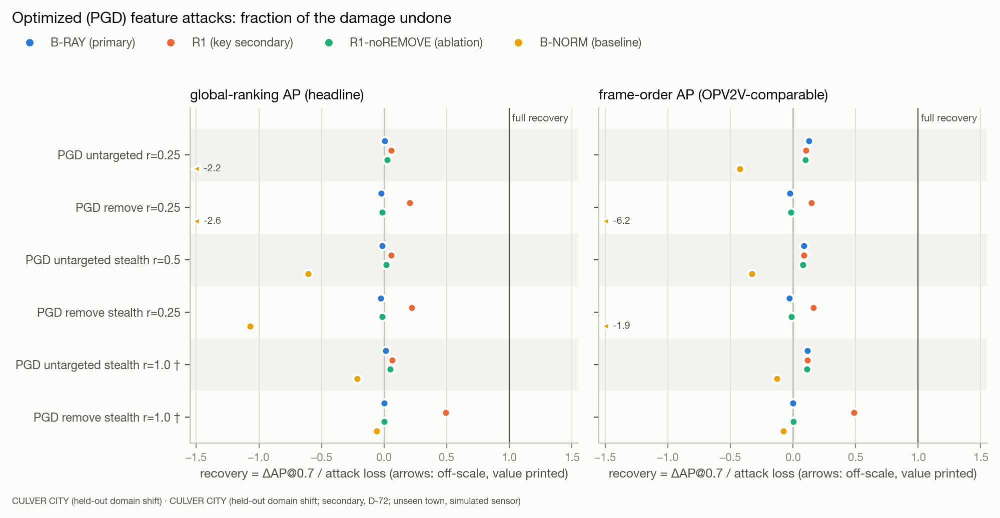

*Figure 5. Recovery = ΔAP@0.7 / attack loss per optimized-attack condition. n/a when the attack loss is < 0.005.* Data: [`tables/05_pgd_recovery.csv`](tables/05_pgd_recovery.csv) · dark version: [`figures/05_pgd_recovery_dark.png`](figures/05_pgd_recovery_dark.png)

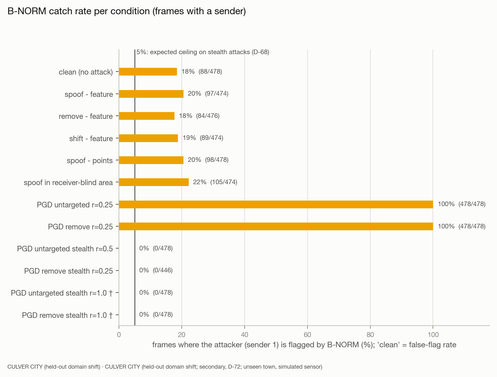

*Figure 6. Share of frames with a sender in which B-NORM flags the attacker; on 'clean' this is the false-flag rate.* Data: [`tables/06_bnorm_catch.csv`](tables/06_bnorm_catch.csv) · dark version: [`figures/06_bnorm_catch_dark.png`](figures/06_bnorm_catch_dark.png)

| Condition | attack loss global | attack loss frame | recovery B-RAY (primary) (global / frame) | recovery R1 (key secondary) (global / frame) | recovery R1-noREMOVE (ablation) (global / frame) | recovery B-NORM (baseline) (global / frame) | recovery Ego-only (global / frame) | B-NORM catch | stealth-infeasible / frames with sender | realized / applied |
|---|---|---|---|---|---|---|---|---|---|---|
| PGD untargeted r=0.25 | +5.35 | +14.02 | 0.00 / 0.13 | 0.06 / 0.10 | 0.02 / 0.10 | -2.20 / -0.42 | -2.62 / -0.62 | 100% | 0/478 | 475/478 |
| PGD remove r=0.25 | +4.75 | +2.76 | -0.02 / -0.03 | 0.20 / 0.15 | -0.02 / -0.02 | -2.61 / -6.24 | -3.08 / -7.22 | 100% | 0/478 | 454/478 |
| PGD untargeted stealth r=0.5 | +4.71 | +10.99 | -0.01 / 0.09 | 0.06 / 0.09 | 0.02 / 0.08 | -0.61 / -0.33 | -3.11 / -1.06 | 0% | 0/478 | 461/478 |
| PGD remove stealth r=0.25 | +4.38 | +2.50 | -0.03 / -0.03 | 0.22 / 0.16 | -0.02 / -0.01 | -1.07 / -1.93 | -3.43 / -8.06 | 0% | 32/478 | 421/446 |
| PGD untargeted stealth r=1.0 † | +13.70 | +27.64 | 0.01 / 0.11 | 0.06 / 0.11 | 0.05 / 0.11 | -0.22 / -0.13 | -0.42 / 0.18 | 0% | 0/478 | 476/478 |
| PGD remove stealth r=1.0 † | +39.82 | +36.90 | -0.00 / 0.00 | 0.49 / 0.49 | 0.00 / 0.00 | -0.06 / -0.08 | 0.51 / 0.39 | 0% | 0/478 | 478/478 |

**Expected outcomes, checked descriptively** (rules stated in the preregistration before any PGD run; not criteria):

| Condition | B-RAY ≈ 0 (point recovery < 0.10 under both AP definitions) | R1 > 0 (R1 dAP@0.7 scenario-CI low > 0 under both AP definitions) | B-NORM ≤ 5% (sender-1 flag rate over attacked frames <= 0.05) |
|---|---|---|---|
| PGD untargeted r=0.25 | no | not applicable | not applicable |
| PGD remove r=0.25 | yes | yes | not applicable |
| PGD untargeted stealth r=0.5 | yes | not applicable | yes |
| PGD remove stealth r=0.25 | yes | yes | yes |
| PGD untargeted stealth r=1.0 † | no | not applicable | yes |
| PGD remove stealth r=1.0 † | yes | yes | yes |

## 9. Attack strength and realized-only effects

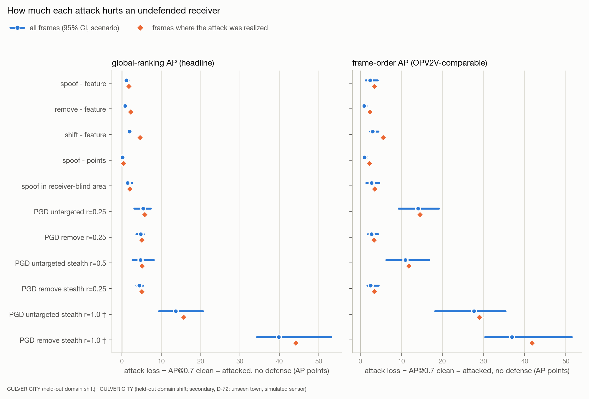

*Figure 7. Attack loss per condition over all frames (with CI) and over the frames where the attack was realized.* Data: [`tables/07_attack_strength.csv`](tables/07_attack_strength.csv) · dark version: [`figures/07_attack_strength_dark.png`](figures/07_attack_strength_dark.png)

**Realized frames only, global-ranking AP (headline)** (ΔAP@0.7 in AP points, recovery in brackets)

| Condition | realized frames | attack loss | B-RAY (primary) ΔAP (recovery) | R1 (key secondary) ΔAP (recovery) | R1-noREMOVE (ablation) ΔAP (recovery) | B-NORM (baseline) ΔAP (recovery) | Ego-only ΔAP (recovery) |
|---|---|---|---|---|---|---|---|
| spoof - feature | 332 | +1.80 | +0.42 (0.23) | +0.54 (0.30) | +0.37 (0.20) | -8.15 (-4.52) | -20.50 (-11.37) |
| remove - feature | 108 | +2.26 | -0.09 (-0.04) | +0.65 (0.29) | -0.07 (-0.03) | -7.91 (-3.49) | -20.71 (-9.14) |
| shift - feature | 135 | +4.63 | +0.12 (0.03) | +0.45 (0.10) | +0.19 (0.04) | -8.19 (-1.77) | -18.30 (-3.95) |
| spoof - points | 228 | +0.41 | +0.07 (n/a) | +0.27 (n/a) | +0.08 (n/a) | -8.84 (n/a) | -21.99 (n/a) |
| spoof in receiver-blind area | 400 | +2.00 | -0.06 (-0.03) | +0.12 (0.06) | -0.07 (-0.04) | -8.48 (-4.24) | -20.15 (-10.07) |
| PGD untargeted r=0.25 | 475 | +5.85 | +0.05 (0.01) | +0.36 (0.06) | +0.14 (0.03) | -13.74 (-2.35) | -16.25 (-2.78) |
| PGD remove r=0.25 | 454 | +5.10 | -0.13 (-0.03) | +1.13 (0.22) | -0.09 (-0.02) | -14.63 (-2.87) | -17.18 (-3.37) |
| PGD untargeted stealth r=0.5 | 461 | +5.19 | -0.05 (-0.01) | +0.32 (0.06) | +0.09 (0.02) | -3.19 (-0.61) | -16.90 (-3.25) |
| PGD remove stealth r=0.25 | 421 | +5.07 | -0.15 (-0.03) | +1.21 (0.24) | -0.10 (-0.02) | -3.10 (-0.61) | -16.44 (-3.24) |
| PGD untargeted stealth r=1.0 † | 476 | +15.68 | +0.24 (0.01) | +1.02 (0.07) | +0.80 (0.05) | -3.38 (-0.21) | -6.43 (-0.41) |
| PGD remove stealth r=1.0 † | 478 | +44.16 | -0.04 (-0.00) | +21.56 (0.49) | +0.10 (0.00) | -2.71 (-0.06) | +22.03 (0.50) |

**Realized frames only, frame-order AP (OPV2V-comparable)** (ΔAP@0.7 in AP points, recovery in brackets)

| Condition | realized frames | attack loss | B-RAY (primary) ΔAP (recovery) | R1 (key secondary) ΔAP (recovery) | R1-noREMOVE (ablation) ΔAP (recovery) | B-NORM (baseline) ΔAP (recovery) | Ego-only ΔAP (recovery) |
|---|---|---|---|---|---|---|---|
| spoof - feature | 332 | +3.41 | +1.16 (0.34) | +0.89 (0.26) | +0.86 (0.25) | -7.83 (-2.29) | -21.60 (-6.32) |
| remove - feature | 108 | +2.39 | -0.00 (-0.00) | +0.42 (0.17) | -0.07 (-0.03) | -7.66 (-3.21) | -23.27 (-9.75) |
| shift - feature | 135 | +5.60 | +0.73 (0.13) | +0.58 (0.10) | +0.45 (0.08) | -7.91 (-1.41) | -20.33 (-3.63) |
| spoof - points | 228 | +2.25 | +0.95 (0.42) | +0.62 (0.28) | +0.68 (0.30) | -8.62 (-3.83) | -23.05 (-10.23) |
| spoof in receiver-blind area | 400 | +3.49 | +0.11 (0.03) | -0.01 (-0.00) | -0.02 (-0.01) | -8.29 (-2.38) | -21.31 (-6.11) |
| PGD untargeted r=0.25 | 475 | +14.52 | +1.84 (0.13) | +1.52 (0.10) | +1.43 (0.10) | -7.45 (-0.51) | -10.29 (-0.71) |
| PGD remove r=0.25 | 454 | +3.38 | -0.08 (-0.02) | +0.58 (0.17) | -0.06 (-0.02) | -18.60 (-5.51) | -21.53 (-6.37) |
| PGD untargeted stealth r=0.5 | 461 | +11.83 | +1.01 (0.09) | +1.01 (0.09) | +0.92 (0.08) | -3.86 (-0.33) | -12.98 (-1.10) |
| PGD remove stealth r=0.25 | 421 | +3.45 | -0.09 (-0.03) | +0.69 (0.20) | -0.04 (-0.01) | -3.33 (-0.97) | -20.81 (-6.03) |
| PGD untargeted stealth r=1.0 † | 476 | +29.00 | +3.22 (0.11) | +3.30 (0.11) | +3.17 (0.11) | -3.88 (-0.13) | +4.16 (0.14) |
| PGD remove stealth r=1.0 † | 478 | +41.84 | +0.01 (0.00) | +20.49 (0.49) | +0.18 (0.00) | -3.03 (-0.07) | +16.96 (0.41) |

## 10. How the defenses act

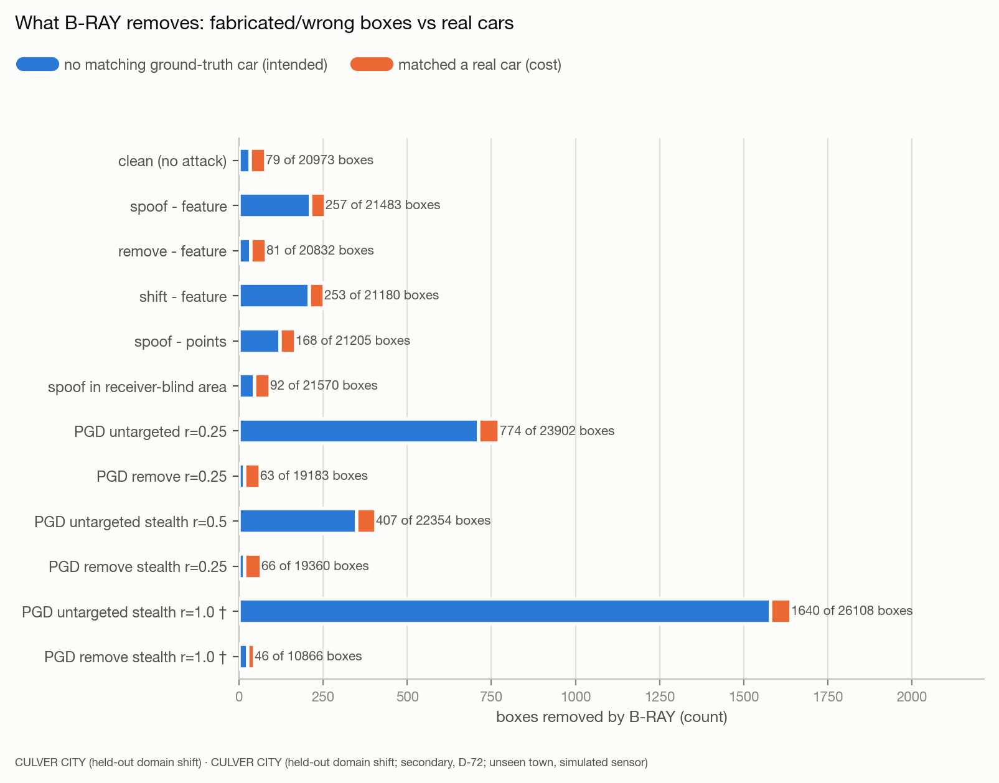

*Figure 8. Boxes B-RAY removed, split by whether they matched a real car.* Data: [`tables/08_bray_boxes.csv`](tables/08_bray_boxes.csv) · dark version: [`figures/08_bray_boxes_dark.png`](figures/08_bray_boxes_dark.png)

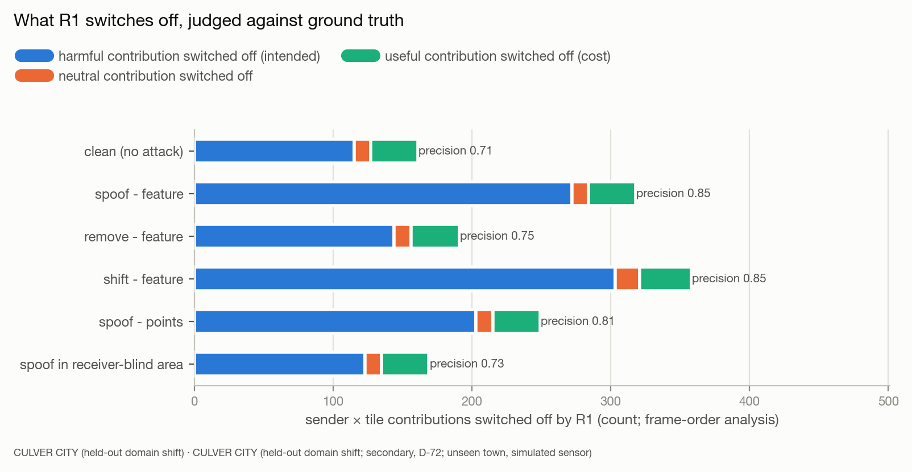

*Figure 9. Contributions (sender × 6.4 m tile) R1 switched off, by their ground-truth label.* Data: [`tables/09_r1_units.csv`](tables/09_r1_units.csv) · dark version: [`figures/09_r1_units_dark.png`](figures/09_r1_units_dark.png)

## 11. By number of cars

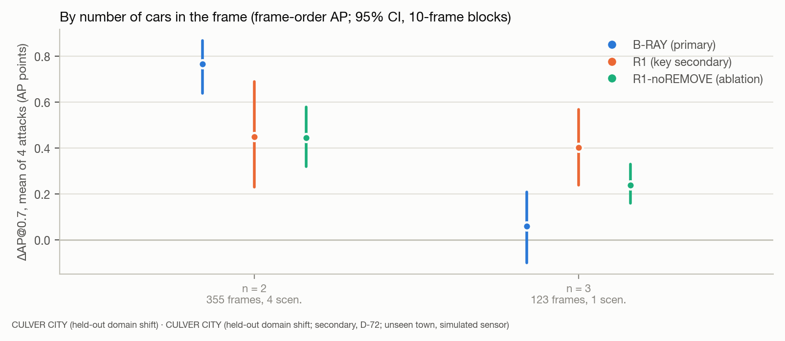

*Figure 10. Mean ΔAP@0.7 over the 4 original attacks per agent count (frozen v2 analysis, frame-order AP).* Data: [`tables/10_by_agents.csv`](tables/10_by_agents.csv) · dark version: [`figures/10_by_agents_dark.png`](figures/10_by_agents_dark.png)

**Runtime by number of cars** (frozen D-42 timing pass; overhead = extra time / receiver baseline, same machine; Culver City frames have at most 3 cars)

| Data | cars | frames | mode | overhead p50 | overhead p95 | extra s p50 | baseline s p50 |
|---|---|---|---|---|---|---|---|
| OPV2V test | 1 | 119 | B-RAY | 8.4% | 14.3% | 0.029 | 0.395 |
| OPV2V test | 2 | 866 | dense | 20.2% | 46.0% | 0.075 | 0.391 |
| OPV2V test | 2 | 866 | trigger_0.05 | 9.6% | 34.3% | 0.035 | 0.391 |
| OPV2V test | 2 | 866 | B-RAY | 3.5% | 11.3% | 0.013 | 0.391 |
| OPV2V test | 3 | 869 | dense | 52.9% | 102.2% | 0.218 | 0.422 |
| OPV2V test | 3 | 869 | trigger_0.05 | 39.9% | 92.7% | 0.149 | 0.422 |
| OPV2V test | 3 | 869 | B-RAY | 9.2% | 20.3% | 0.034 | 0.422 |
| OPV2V test | 4+ | 212 | dense | 122.7% | 169.7% | 0.649 | 0.517 |
| OPV2V test | 4+ | 212 | trigger_0.05 | 77.0% | 128.2% | 0.372 | 0.517 |
| OPV2V test | 4+ | 212 | B-RAY | 11.1% | 16.4% | 0.051 | 0.517 |
| Culver City | 1 | 72 | B-RAY | 21.0% | 31.2% | 0.082 | 0.463 |
| Culver City | 2 | 355 | dense | 45.8% | 81.2% | 0.202 | 0.441 |
| Culver City | 2 | 355 | trigger_0.05 | 41.8% | 83.5% | 0.176 | 0.441 |
| Culver City | 2 | 355 | B-RAY | 20.2% | 32.4% | 0.079 | 0.441 |
| Culver City | 3 | 123 | dense | 105.4% | 171.7% | 0.509 | 0.485 |
| Culver City | 3 | 123 | trigger_0.05 | 98.5% | 165.2% | 0.474 | 0.485 |
| Culver City | 3 | 123 | B-RAY | 27.2% | 38.9% | 0.113 | 0.485 |

## 12. OPV2V test vs Culver City (headline numbers, kept separate)

Two separate evaluations of the same frozen code, never pooled. Left: the OPV2V final test (FINAL TEST (one-time), primary). Right: Culver City (this report, secondary, 4 scenarios: coarse scenario CIs). ΔAP in AP points. Data: [`tables/11_test_vs_culver.csv`](tables/11_test_vs_culver.csv)

| Statistic | AP definition | OPV2V test (primary, 15 scen.) | Culver City (secondary, 4 scen.) |
|---|---|---|---|
| Scenarios / frames | - | 15 / 2066 | 4 / 550 |
| Agents per frame | - | {'1': 119, '2': 866, '3': 869, '4': 111, '5': 101} | {'1': 72, '2': 355, '3': 123} |
| No-defense clean AP@0.7 (absolute) | global-ranking AP (headline) | 0.8864 | 0.7746 |
| No-defense clean AP@0.7 (absolute) | frame-order AP (OPV2V-comparable) | 0.8217 | 0.7359 |
| B-RAY (primary): mean ΔAP@0.7, 4 original attacks (pts, scen. CI) | global-ranking AP (headline) | +0.15 [-0.01, +0.30] | +0.05 [-0.03, +0.13] |
| B-RAY (primary): mean ΔAP@0.7, 4 original attacks (pts, scen. CI) | frame-order AP (OPV2V-comparable) | +0.76 [+0.49, +1.27] | +0.54 [+0.22, +0.92] |
| R1 (key secondary): mean ΔAP@0.7, 4 original attacks (pts, scen. CI) | global-ranking AP (headline) | +0.45 [+0.29, +0.70] | +0.32 [+0.21, +0.48] |
| R1 (key secondary): mean ΔAP@0.7, 4 original attacks (pts, scen. CI) | frame-order AP (OPV2V-comparable) | +0.19 [-0.45, +0.52] | +0.40 [+0.21, +0.73] |
| R1-noREMOVE (ablation): mean ΔAP@0.7, 4 original attacks (pts, scen. CI) | global-ranking AP (headline) | +0.26 [+0.18, +0.36] | +0.08 [-0.05, +0.18] |
| R1-noREMOVE (ablation): mean ΔAP@0.7, 4 original attacks (pts, scen. CI) | frame-order AP (OPV2V-comparable) | +0.66 [+0.48, +1.03] | +0.38 [+0.23, +0.63] |
| B-NORM (baseline): mean ΔAP@0.7, 4 original attacks (pts, scen. CI) | global-ranking AP (headline) | -5.85 [-9.65, -2.30] | -6.72 [-9.17, -0.57] |
| B-NORM (baseline): mean ΔAP@0.7, 4 original attacks (pts, scen. CI) | frame-order AP (OPV2V-comparable) | -7.13 [-11.82, -2.73] | -6.72 [-9.59, -0.93] |
| Ego-only: mean ΔAP@0.7, 4 original attacks (pts, scen. CI) | global-ranking AP (headline) | -20.02 [-23.10, -16.04] | -18.36 [-23.17, -14.57] |
| Ego-only: mean ΔAP@0.7, 4 original attacks (pts, scen. CI) | frame-order AP (OPV2V-comparable) | -24.20 [-29.44, -18.65] | -20.81 [-25.17, -16.70] |
| B-RAY (primary): clean relative AP@0.7 loss (scen. CI) | global-ranking AP (headline) | 0.13% [+0.01, +0.30] | 0.14% [+0.08, +0.19] |
| B-RAY (primary): clean relative AP@0.7 loss (scen. CI) | frame-order AP (OPV2V-comparable) | -0.05% [-0.30, +0.18] | -0.07% [-0.18, +0.07] |
| R1 (key secondary): clean relative AP@0.7 loss (scen. CI) | global-ranking AP (headline) | -0.16% [-0.35, -0.01] | -0.17% [-0.35, +0.03] |
| R1 (key secondary): clean relative AP@0.7 loss (scen. CI) | frame-order AP (OPV2V-comparable) | 0.62% [+0.18, +1.75] | 0.06% [-0.23, +0.37] |
| Holm co-test vs no defense (1-sided, scenario bootstrap) | global-ranking AP (headline) | B-RAY p=0.0335 reject; R1 p=0.0005 reject | B-RAY p=0.1209 no reject; R1 p=0.0005 reject |
| Holm co-test vs no defense (1-sided, scenario bootstrap) | frame-order AP (OPV2V-comparable) | B-RAY p=0.0005 reject; R1 p=0.2259 no reject | B-RAY p=0.0005 reject; R1 p=0.0005 reject |
| v2 success rule (B-RAY Holm reject and clean CI high <= 1%) | global-ranking AP (headline) | passes | does not pass |
| v2 success rule (B-RAY Holm reject and clean CI high <= 1%) | frame-order AP (OPV2V-comparable) | passes | passes |
| D-64 verdict | - | success under both AP definitions | AP-definition-dependent |
| R1 − B-RAY, mean of 4 (pts, scen. CI) and statement | global-ranking AP (headline) | +0.31 [+0.12, +0.55]: “the counterfactual improves over the box-level filter” | +0.27 [+0.12, +0.48]: “the counterfactual improves over the box-level filter” |
| R1 − B-RAY, mean of 4 (pts, scen. CI) and statement | frame-order AP (OPV2V-comparable) | -0.57 [-1.64, -0.11]: “the counterfactual performs worse than the box-level filter” | -0.14 [-0.40, +0.19]: “the counterfactual's benefit over a box-level filter is not established” |
| spoof in receiver-blind area: attack loss, ΔAP (recovery) | global-ranking AP (headline) | loss +2.21; B-RAY -0.01 (rec. -0.00); R1 +0.19 (rec. 0.09) | loss +1.45; B-RAY -0.07 (rec. -0.05); R1 +0.14 (rec. 0.10) |
| spoof in receiver-blind area: attack loss, ΔAP (recovery) | frame-order AP (OPV2V-comparable) | loss +4.39; B-RAY +0.14 (rec. 0.03); R1 -0.34 (rec. -0.08) | loss +2.73; B-RAY +0.07 (rec. 0.03); R1 +0.01 (rec. 0.00) |
| PGD remove stealth r=0.25: attack loss, ΔAP (recovery) | global-ranking AP (headline) | loss +3.06; B-RAY -0.10 (rec. -0.03); R1 +1.13 (rec. 0.37) | loss +4.38; B-RAY -0.12 (rec. -0.03); R1 +0.96 (rec. 0.22) |
| PGD remove stealth r=0.25: attack loss, ΔAP (recovery) | frame-order AP (OPV2V-comparable) | loss +1.14; B-RAY -0.02 (rec. -0.02); R1 -0.14 (rec. -0.13) | loss +2.50; B-RAY -0.07 (rec. -0.03); R1 +0.41 (rec. 0.16) |
| PGD remove stealth r=1.0: attack loss, ΔAP (recovery) | global-ranking AP (headline) | loss +40.41; B-RAY -0.01 (rec. -0.00); R1 +22.50 (rec. 0.56) | loss +39.82; B-RAY -0.03 (rec. -0.00); R1 +19.53 (rec. 0.49) |
| PGD remove stealth r=1.0: attack loss, ΔAP (recovery) | frame-order AP (OPV2V-comparable) | loss +36.51; B-RAY +0.06 (rec. 0.00); R1 +20.94 (rec. 0.57) | loss +36.90; B-RAY +0.02 (rec. 0.00); R1 +17.93 (rec. 0.49) |
| PGD untargeted stealth r=1.0: attack loss, ΔAP (recovery) | global-ranking AP (headline) | loss +8.86; B-RAY +0.12 (rec. 0.01); R1 +0.40 (rec. 0.04) | loss +13.70; B-RAY +0.18 (rec. 0.01); R1 +0.88 (rec. 0.06) |
| PGD untargeted stealth r=1.0: attack loss, ΔAP (recovery) | frame-order AP (OPV2V-comparable) | loss +20.10; B-RAY +2.09 (rec. 0.10); R1 +1.33 (rec. 0.07) | loss +27.64; B-RAY +3.14 (rec. 0.11); R1 +3.14 (rec. 0.11) |
| B-NORM sender-1 flag rate, clean (no attack) | - | 17.4% | 18.4% |
| B-NORM sender-1 flag rate, PGD untargeted r=0.25 | - | 100.0% | 100.0% |
| B-NORM sender-1 flag rate, PGD untargeted stealth r=0.5 | - | 0.0% | 0.0% |

**Expected outcomes stated in the plan before any Culver City number** (from the OPV2V test only; descriptive, not criteria):

- *clean_detector*: no-defense frame-order AP@0.7 over the 4 scenarios within about +-0.05 of 0.735 (lower than the test's 0.822); global-ranking AP higher than frame-order, as on the test (0.886 vs 0.822)
- *headline_mean4*: same signs as the test: global AP R1 > B-RAY >= 0, both below 1 AP point (test +0.45 / +0.15); frame-order AP B-RAY > R1 (test +0.76 / +0.19); R1 - B-RAY AP-definition-dependent as on the test; wider CIs, so the v2 rule may fail under one or both definitions by lack of power
- *clean_cost*: B-RAY relative loss below 1% (point); R1 clean cost under frame-order AP positive (test 0.62%) and near zero or negative under global AP; R1-noREMOVE near 0
- *domain_shift*: more detector false positives in an unseen town may give B-RAY more boxes to remove; whether that helps or hurts clean AP is not predicted
- *B-NORM*: catch ~100% on plain PGD; <= 5% on stealth PGD; clean false-flag rate and AP cost at least as large as on the test (tau_k fitted on default-town block H), so B-NORM clean cost likely several AP points
- *PGD*: B-RAY recovery ~0 on every PGD condition; R1 recovery on pgd_remove_stealth@r1.0 around 0.5 (test 0.56) and > 0 on the r = 0.25 remove families under global AP
- *spoof_blind*: no defense recovers it (identifiability limit), as on the test
- *fewer_agents*: Culver frames have n <= 3 (test up to 5), so per-agent-count comparisons cover n = 2, 3 only

## 13. Interpretation (AUTHOR)

<!-- AUTHOR: write this section only after reading sections 2-12. Keep to what the numbers support. -->
*To be written by the authors.* Suggested questions, answered from the tables above:

1. Does the v3.2 rule hold on Culver City under both AP definitions, and how large are the effects in AP points? (Descriptive; the test verdict stands.)
2. Is the clean cost within the 1% limit in an unseen town, and what does B-RAY remove (section 10)?
3. Does the R1 − B-RAY statement match the test's under each AP definition?
4. Which attacks remain unrecovered, and is the picture the same as on the test?
5. Which differences from the test (section 12) exceed what 4 scenarios can resolve?

## 14. Scope, labelling and deviations

**Domain shift, not real data.** Culver City is simulated with the same CARLA LiDAR model as the OPV2V test; it tests transfer to an unseen town layout, not to real sensors, real traffic or real attacks.

**Scope limits (pre-registered).** D-54 and D-63 (single attacker; random placement for the E4 families; spoof_blind bypass; ray-consistent / low-ray spoofs; B-RAY cannot restore removed objects; receiver sensor trusted; CARLA LiDAR; method chosen on exposed H), plus: PGD is white-box on this checkpoint with budgets relative to its clean H feature scale; B-NORM's threshold is fitted on clean H

**Labelling (OPV2V test preregistration).** Test numbers are the one-time final test. All E0-E5a numbers (blocks T and H) are development or held-out-but-exposed and are reported separately. v2 is the governing pre-registration. Culver City numbers are a separate, secondary held-out evaluation (D-72) and are labelled "unseen town, simulated sensor".

**Reporting rules (D-69).** Headline AP: global-ranking AP (D-64). absolute dAP in AP points next to every recovery. Scope: R1 cannot verify removals in receiver-blind regions (a removed object the receiver cannot see is UNKNOWN = keep).

**D-71 (part of the frozen v3.2 code used here).** runners/v3_2_stream.py: v3_extra = the v3.1 v3_extra with the copy loop replaced by copy_mabs: a record without 'mabs' is skipped after asserting ledger reason == 'stealth_infeasible' (any other cause still fails). Same reading as the frozen v3_analyze.frames_test ('if "mabs" in rec') and cond_of (no 'cands' -> clean, not applied). install() = v3.1 install() + v3_extra and preregistration swapped; v3/v3.1 frozen files byte-identical (The crash it fixed happened on the OPV2V test stream, not on Culver City.)

## Appendix: absolute AP@0.7

**global-ranking AP (headline)**

| Condition | No defense | B-RAY (primary) | R1 (key secondary) | R1-noREMOVE (ablation) | B-NORM (baseline) | Ego-only |
|---|---|---|---|---|---|---|
| clean (no attack) | 0.7746 | 0.7735 | 0.7759 | 0.7739 | 0.7067 | 0.5807 |
| spoof - feature | 0.7631 | 0.7654 | 0.7673 | 0.7654 | 0.6949 | 0.5807 |
| remove - feature | 0.7666 | 0.7656 | 0.7689 | 0.7660 | 0.7017 | 0.5807 |
| shift - feature | 0.7548 | 0.7561 | 0.7591 | 0.7567 | 0.6900 | 0.5807 |
| spoof - points | 0.7729 | 0.7725 | 0.7748 | 0.7728 | 0.7020 | 0.5807 |
| spoof in receiver-blind area | 0.7601 | 0.7593 | 0.7615 | 0.7595 | 0.6895 | 0.5807 |
| PGD untargeted r=0.25 | 0.7211 | 0.7213 | 0.7242 | 0.7223 | 0.6032 | 0.5807 |
| PGD remove r=0.25 | 0.7270 | 0.7258 | 0.7368 | 0.7263 | 0.6032 | 0.5807 |
| PGD untargeted stealth r=0.5 | 0.7274 | 0.7268 | 0.7301 | 0.7282 | 0.6988 | 0.5807 |
| PGD remove stealth r=0.25 | 0.7308 | 0.7295 | 0.7404 | 0.7300 | 0.6840 | 0.5807 |
| PGD untargeted stealth r=1.0 † | 0.6376 | 0.6394 | 0.6463 | 0.6445 | 0.6079 | 0.5807 |
| PGD remove stealth r=1.0 † | 0.3764 | 0.3761 | 0.5717 | 0.3773 | 0.3535 | 0.5807 |

**frame-order AP (OPV2V-comparable)**

| Condition | No defense | B-RAY (primary) | R1 (key secondary) | R1-noREMOVE (ablation) | B-NORM (baseline) | Ego-only |
|---|---|---|---|---|---|---|
| clean (no attack) | 0.7359 | 0.7365 | 0.7355 | 0.7358 | 0.6675 | 0.5094 |
| spoof - feature | 0.7122 | 0.7207 | 0.7185 | 0.7184 | 0.6441 | 0.5094 |
| remove - feature | 0.7263 | 0.7271 | 0.7267 | 0.7262 | 0.6607 | 0.5094 |
| shift - feature | 0.7056 | 0.7133 | 0.7121 | 0.7118 | 0.6410 | 0.5094 |
| spoof - points | 0.7259 | 0.7302 | 0.7286 | 0.7287 | 0.6554 | 0.5094 |
| spoof in receiver-blind area | 0.7086 | 0.7093 | 0.7087 | 0.7086 | 0.6376 | 0.5094 |
| PGD untargeted r=0.25 | 0.5957 | 0.6137 | 0.6103 | 0.6096 | 0.5363 | 0.5094 |
| PGD remove r=0.25 | 0.7083 | 0.7076 | 0.7124 | 0.7078 | 0.5363 | 0.5094 |
| PGD untargeted stealth r=0.5 | 0.6260 | 0.6355 | 0.6354 | 0.6347 | 0.5901 | 0.5094 |
| PGD remove stealth r=0.25 | 0.7109 | 0.7102 | 0.7150 | 0.7106 | 0.6627 | 0.5094 |
| PGD untargeted stealth r=1.0 † | 0.4595 | 0.4908 | 0.4909 | 0.4898 | 0.4234 | 0.5094 |
| PGD remove stealth r=1.0 † | 0.3669 | 0.3671 | 0.5462 | 0.3688 | 0.3381 | 0.5094 |

